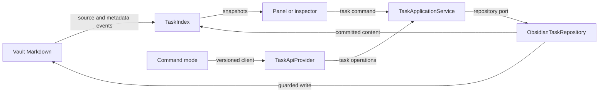

# Architecture

Abyss Tasks presents the same vault tasks in a sidebar, calendar, project views, and Analysis.
Markdown holds the authored data. The plugin indexes it for reads and routes changes through
application commands. Start with the flow below when a change crosses a view, the task model,
or storage. The section for each workflow points to the tests that exercise its boundaries.

## From a note to the screen and back

[main.ts](src/main.ts) is the Obsidian entry point. It builds the task index, repository,
application service, and shared search service. It supplies capabilities to the views and
releases plugin-owned services on unload. A new view receives the existing service through the
[internal task API](src/tasks/index.ts).

- The [domain](src/tasks/domain/) owns task references, commands, status, dates, recurrence,
  and the meaning of a change. The [application layer](src/tasks/application/) resolves targets,
  applies those rules, and returns structured outcomes through its ports.
- [Infrastructure](src/tasks/infrastructure/) implements the ports. The Markdown codec reads task
  blocks, the block editor changes their source, and the Obsidian repository coordinates writes.
  New task syntax belongs at this boundary. Some established views still consume the
  [legacy parser](src/parser/), which can reuse the canonical codec.
- Presentation reads snapshots and translates interactions into commands. External plugins
  and Command mode use a separate, versioned client described [below](#public-client-and-command-mode).

## Where state lives

| Data                                                         | Durable source or current owner                                                                                                   |
| ------------------------------------------------------------ | --------------------------------------------------------------------------------------------------------------------------------- |
| Task hierarchy, fields, comments, dependencies, time entries | Vault Markdown. The index, search results, forecasts, and totals can be rebuilt.                                                  |
| Project membership and properties                            | Project notes and configured membership rules. Each panel's ProjectStore derives its project list and statistics.                 |
| Configuration and saved views                                | Static preferences in `data.json` and versioned view preferences in `state.json`. Both contribute to the runtime settings object. |
| Current navigation, selection, inspector drafts and undo     | The view's AppState and interaction controllers. Their lifetime is the open view.                                                 |
| Command conversations, proposals, write journal              | Session files in the plugin directory, managed by CommandSessionStore. They survive reopening.                                    |
| Credentials                                                  | Obsidian SecretStorage. Settings hold provider choices and secret bindings.                                                       |

### Change a setting or a saved view

First decide who must remember the value. A project field definition belongs to static
configuration, its column visibility belongs to saved view state, and the cell being edited
belongs to the current interaction. Classify a new persisted key in the
[settings ownership roster](test/architecture/settingsOwnership.ts) and route it through the
[settings coordinator](src/settings/persistence.ts). Changing the configured checkbox statuses also
updates the status catalog, the UI registry, and the index's interpretation of those symbols.

The coordinator preserves unknown persisted fields. When migrating saved views, it verifies
the new envelope before cleaning up the legacy values. If the stored view state is unreadable
or newer than the supported schema, the plugin uses temporary defaults and suspends writes
to that state. Static and view-state saves can fail separately. Exercise the actual coordinator
with older data, an unknown extension, and a failed write.
[Persistence tests](test/settings-persistence.test.ts) · [Status settings tests](test/settings-tab-statuses.test.ts)

## Task changes

### Edit a task after the note has changed

1. [TaskIndex](src/tasks/infrastructure/TaskIndex.ts) parses accepted source with the
   [Markdown codec](src/tasks/infrastructure/markdown/TaskMarkdownCodec.ts). List-item metadata
   helps discovery. Authored tasks can still exist when the host cache omits them. Queries
   return detached snapshots within the current source policy.
2. The view captures the chosen occurrence, including the parent chain for a subtask.
   [TaskApplicationService](src/tasks/application/TaskApplicationService.ts) resolves that
   reference, validates the command, and delegates the write to the repository. A title,
   checkbox position, or search result can help a person find a task. None uniquely identifies
   an identically named sibling after an edit.
3. [ObsidianTaskRepository](src/tasks/infrastructure/obsidian/ObsidianTaskRepository.ts) checks the
   write against current source and serializes mutations per file. After committing, it installs
   the resulting content in the index. Subsequent Obsidian events reconcile the note through
   the same source model. [TaskRefAuthority](src/tasks/infrastructure/TaskRefAuthority.ts)
   tracks which occurrences can be followed across accepted changes.
4. The initiating view handles the outcome. A missing or ambiguous target, a revision conflict,
   and a successful write require different feedback. A later selection belongs to the user.
   An earlier write may complete, but its callback must still prove ownership before updating
   the inspector or revealing a task.

For a new editable field, follow the command from its [domain definition](src/tasks/domain/commands.ts)
through application validation to the [block editor](src/tasks/infrastructure/markdown/TaskBlockEditor.ts).
Check the exact Markdown after editing a nested task, including untouched sibling content.
For a staged edit, the [preparation API](src/tasks/application/TaskEditPreparationApi.ts)
produces the before/after tree in memory. An intervening source change can invalidate a plan.
Refreshing it requires proof that the reviewed edit still applies.
[Codec tests](test/tasks/markdown-codec.test.ts) · [Reference tests](test/tasks/task-ref-authority.test.ts) · [Plan refresh tests](test/tasks/task-preparation-refresh.test.ts)

If Command mode should edit that field, also follow the [public patch validator](src/integrations/taskContentValidation.ts)
and the [model-facing schema](src/ai/commandSchemas.ts). Each controls which fields its callers
can send. A field that saves from the inspector can still be rejected at either boundary.
Test selecting it from a larger proposal and confirm that the other fields remain pending.
[Public field-selection tests](test/public-api-content-selection.test.ts)

### Create a task or change completion behavior

Capture asks the application to plan a destination, such as the configured task file or today's
note. The retained creation session carries the destination, insertion policy, and settings
used for the preview. Submitting freezes that request independently of later typing.
With Continuous voice enabled, ordinary Q submits one transcript through this creation session
and closes after a successful write. In Command Mode, speech goes to the command queue and
the listening surface resumes after a save starts a fresh session.
[NoteTemplateService](src/notes/NoteTemplateService.ts) prepares a required note at execution.
After creation, the view can reveal the accepted task. If the write outcome is unknown, the
user needs to inspect the destination before retrying.
[Capture controller](src/ui/taskCapture/TaskCaptureController.ts) · [Capture tests](test/task-capture-controller.test.ts)

Completion can affect more than the checkbox. The application checks dependencies, applies the
configured recurrence behavior, and closes affected running timers through the tracking service.
A failed timer follow-up can leave the status change committed. Use the existing status command
from every surface that changes completion, and report the actual effects. Changing a checkbox
directly in Markdown causes the index to reread it without replaying those command side effects.
[Dependency service](src/tasks/application/TaskDependencyService.ts) · [Status follow-up tests](test/tasks/task-status-follow-up.test.ts)

### Move, archive, or change which component writes

Moves and archives across notes write the destination before removing the source. An unknown
destination outcome leaves the source untouched. If the destination is confirmed and source
removal fails, the [move result handler](src/ui/taskCommandResult.ts) opens recovery. The
[recovery modal](src/ui/TaskMoveRecoveryModal.ts) resolves the original task before offering to
delete it. If its revision changed, removal needs renewed user acceptance. If the recovery
delete has an unknown outcome, the user must inspect both notes before retrying.
[Repository move contract](test/tasks/task-repository-move-contract.test.ts) · [Recovery UI tests](test/task-move-recovery-ui.test.ts)

Use [TaskHierarchyService](src/tasks/application/TaskHierarchyService.ts) for reparenting and
promotion. For other text writes, follow the owner of that part of the file. ProjectManager owns
project metadata, NoteApplicationService guards prepared prose sections and preserves task blocks
and frontmatter, NoteTemplateService handles note creation, and TagManager owns global tag renames.
The [storage authority roster](test/architecture/storageAuthority.ts) names each authorized
writer and host API. A new acquisition needs a narrowly scoped reason and tests for both
acceptance and rejection.

## Views and derived data

[PanelView](src/views/PanelView.ts) owns the sidebar and its lifetime. The rail switches modes,
the left panel handles navigation, and the center hosts task collections, calendar, projects,
search, and Analysis. The right panel owns inspector edits, drafts, and undo.
[TaskModal](src/ui/TaskModal.ts) reuses that inspector with its own selection. Reuse the
[task menu](src/ui/taskContextMenu.ts), card renderer, and panel commands when exposing an
existing action on another surface. Capture the clicked node when constructing the action.
Opening a menu on one task must still target that task if the inspector selection later changes.
[Menu tests](test/task-menus.test.ts) · [Inspector writer tests](test/right-panel-writers.test.ts) · [Inspector history tests](test/inspector-history-transitions.test.ts)

**Collections and search.** List, Kanban, and Timeline share the task list surface and card
interactions. Logical rows own order and selection. Each view mounts full cards around the
viewport. Timeline uses the same task cards and calendar tracks during scrolling and at rest.
Vertical wheel steps of half a screen or more mount the destination window in the input handler.
When the scrollbar jumps at least four screens, Timeline also mounts a compact destination window
before paint. After the gesture pauses, small batches prepare neighboring cards. Overlapping Timeline windows keep
recently visited cards within the row budget so a reversal can reuse them. The task and project
timelines paint the grid from the same date boundaries as the header.
Mobile task lists and task timelines estimate unseen row heights from settled cards and retain
the estimate with the scroll position. The center panel remembers the 32 most recently closed
task collection views. A saved position contains the row key, intra-row offset, adjacent keys
and scroll coordinate. Live updates can still use the full previous row order to find a survivor.
Timeline measures wrapping at the width of the task
summary and recalibrates when that width or the card layout changes. On Android the task list
and Timeline publish the destination cards with each vertical swipe and commit the final finger
position on release. A new touch stops the remaining momentum. Calendar tracks keep their
range-edit gestures.
Compact collections batch exact-source lookups and prioritize tasks in the viewport. The search service
discards stale addresses. [TaskSearchService](src/tasks/infrastructure/search/TaskSearchService.ts)

Task and project views share the row geometry for their vertical windows. Each scrolling
surface owns its mounted rows, including any focused or pinned row. The inspector's dependency
picker loads visible candidates before filling the surrounding window during scrolling. Selecting
a loaded option rechecks its identity and eligibility against the current search session.
[Row geometry](src/panels/virtualization/rowViewport.ts) · [Dependency picker tests](test/dependency-search.test.ts)

Change text matching in [searchMatchPolicy](src/tasks/domain/searchMatchPolicy.ts), list membership
in [taskNodeMembership](src/task-lists/taskNodeMembership.ts), and display in the
[search surface](src/panels/center/TaskSearch.ts). Global search returns roots. A task-list
filter can surface an eligible descendant. Preserve that distinction when changing results.
[Search service tests](test/tasks/task-search-service.test.ts) · [Descendant selection tests](test/task-search-organization.test.ts)

**Calendar.** [Calendar occurrences](src/views/calendarOccurrences.ts) project saved tasks and
recurrence forecasts onto dates. A forecast has no editable occurrence of its own. Explicit
series edits target the source task. A drag or keyboard edit captures the task under the
gesture and goes through [calendar commands](src/panels/calendar/calendarCommands.ts).
Queued edits require proof that they still apply to the original target.
[Projection tests](test/calendar-occurrences.test.ts) · [Queued edit after an unverified write](test/calendar-publication.test.ts)

**Projects and Analysis.** [ProjectStore](src/projects/ProjectStore.ts) derives membership from
paths, tags, and frontmatter. Table, Kanban, and Timeline share field definitions and model logic.
[ProjectManager](src/projects/ProjectManager.ts) checks expected metadata when committing a field
edit. Moving a task into a project uses the task application service. Pure project models take
explicit time and data. Analysis consumes a separate [statistics projection](src/tasks/infrastructure/TaskStatisticsProjection.ts)
that can include permitted archive evidence without introducing archived tasks into ordinary
lists. The projection reads cancellation dates and date errors from each physical task line
using the [canonical Markdown grammar](src/tasks/domain/taskLineSourceModel.ts). It reports gaps
in coverage alongside totals.
[Project write tests](test/project-integration-writes.test.ts) · [Statistics source tests](test/tasks/task-statistics-source.test.ts)

## Public client and Command mode

External plugins open a versioned client with `getApi(1, { consumerId })`. Command mode uses the
same [provider](src/integrations/TaskApiProvider.ts) for task, project, and note operations.
Clients receive opaque targets and revisions. Targets can expire and must be resolved again
after a provider reload. Disposing the client releases subscriptions and pending reads. Source
coverage matters. A lookup with incomplete coverage or more pages to read cannot establish absence.
[API guide](API.md) · [External contract](api.d.ts) · [Identity tests](test/public-api-identity.test.ts)

### Add an operation to Command mode

[CommandSessionOwner](src/ai/CommandSessionOwner.ts) coordinates the session shared by panels
and popouts. Adding a task from a menu verifies its native reference and adds it to working
focus. Opening the composer does not submit a turn. When the user submits, the
[agent](src/ai/CommandAgent.ts) receives the instruction, working selection, and bounded
session context.

Start with the existing public operation. The [tool adapter](src/ai/commandTools.ts) translates
model arguments into reads or preparations. [CommandReferenceBook](src/ai/CommandReferenceBook.ts)
binds the model's short edit references to this turn, their owner, and the saved revision or
pending plan. When adding an edit, keep those references out of persisted state.
[commandReads](src/ai/commandReads.ts) reads both sides of the prepared plan to completion at
the plan revision before staging. A first page alone can omit children or comments from review.

If the user specified a file and line and lookup fails, dropping the
line and editing a similarly named task is unsafe. An incomplete result calls for a narrower
read. A complete result with no match can support a clarification.

A successful tool call proves only what that operation did. [CommandEvidence](src/ai/CommandEvidence.ts)
tracks accepted results within the turn. [CommandPendingOperations](src/ai/CommandPendingOperations.ts)
tracks rejected operations that still need repair. An unrelated successful edit cannot clear one.
When adding a command, test the intended final state, the owner, and unrelated data.
Include a case that produces a plausible answer while leaving part of the request undone.
[Agent tests](test/command-agent.test.ts) · [Evaluation workflow](COMMAND_EVALUATION.md)

### Change confirmation or recovery

Ordinary creation and edits produce a reviewable proposal. Confirmation binds to the session
and the proposal revision the user reviewed. If the user approves only one field or one task,
the [authorization check](src/ai/commandWriteAuthorization.ts) evaluates that instruction against
the displayed owners and before/after values. For example, “save the description” must leave
pending comments and date changes in the proposal. [commandSelection](src/ai/commandSelection.ts) checks revisions and
dependencies and prepares the approved subset through the public client. After a partial
field save, the committed request ID anchors the refresh of that task's remaining edits.
If that fails, the session retains the receipt and blocks a repeat save. Empty Enter follows the panel's confirmation path. An explicit instruction to
save new work immediately has a separate check on the completed proposal. After a terminal
agent save, the panel archives the verified journal and opens a fresh session when the
proposal is empty and the composer has received no further edits. Compound commands
continue in the same session.

The [write coordinator](src/ai/commandWrites.ts) records admitted work in the journal before
dispatch. Stop prevents the next batch operation. A request already dispatched may still
commit after Stop or after the panel closes. Receipts and readback
establish what actually changed. If a write committed but its readback failed, keep its
record, surface the uncertainty, and check the current state before taking further action.
[CommandSessionStore](src/ai/CommandSessionStore.ts) persists proposals and journal entries
under the plugin directory. Recovery inspects individual resource outcomes, even if the overall
receipt says committed. Acknowledging uncertainty lets the user begin independent work while
the unresolved record stays in history. Restored handles must be verified before a new edit.
[Field selection tests](test/tasks/task-field-selection.test.ts) · [Approval tests](test/command-write-review.test.ts) · [Partial saves and cancellation](test/command-session.test.ts) · [Recovery tests](test/command-recovery.test.ts) · [Store tests](test/command-session-store.test.ts)

### Change providers or research

Model, voice, and web research connections have separate selections. Credentials go through
Obsidian SecretStorage. The desktop ChatGPT subscription uses its own sign-in. Preserve the
connection the user selected, including its billing route. Before allowing web research, the
agent checks the current request and recent user messages. A page, task comment, or search
result is evidence and cannot authorize a new external request or a task write.

[ProviderResearch](src/ai/providers/ProviderResearch.ts) separates searching for a source from
reading a known URL through a provider that supports extraction. Preserve attribution, failures,
and truncation so a snippet cannot stand in for a page the user asked to read. Record the
requested URL and the URL returned by the provider separately. That metadata cannot verify
the final redirect or the freshness of the page.
[Page-reading tests](test/command-page-reading.test.ts) · [Live evaluation procedure](COMMAND_EVALUATION.md)

## Verifying a change

Use `pnpm verify:task` during development and `pnpm verify` before integration. Import direction
is enforced by the [dependency rules](dependency-cruiser.config.cjs) and
[architecture tests](test/architecture-boundaries.test.ts). For UI work, exercise the actual
interaction in `dev-vault-tasks`, inspect the DOM and screenshots, and check runtime errors.
For performance-sensitive changes, compare the same workload before and after.
[Repository instructions](AGENTS.md) · [Performance guide](PERFORMANCE.md)

Update this map when a change moves ownership, crosses a public boundary, changes where data
is stored, or changes how an edit reaches a verified result. Keep operation schemas with the
public contract and regression examples in the tests linked from the workflow they protect.
