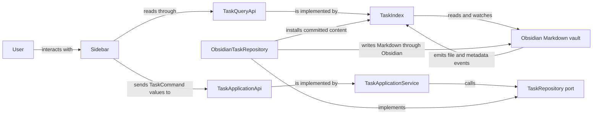

# Architecture

Abyss Tasks manages Markdown tasks through an Obsidian sidebar, with task lists, a calendar,
project views, and Analysis. Markdown is the durable record. The plugin builds read models over
the vault and writes user changes through application commands.

This document describes implemented ownership, sources of truth, dependency direction, and the
contracts that changes must preserve. Source links lead to algorithms and local behavior. Proposed
architecture belongs in an ignored design spec.

## System at a glance



Queries return detached, immutable snapshots. Commands validate current source, perform writes,
and return structured outcomes. Successful writes enter the read model before the command returns;
later vault and metadata events reconcile through the same parsing path as manual edits.

## Sources of truth

| Concern                                                 | Authoritative source                                         | Derived or temporary state            |
| ------------------------------------------------------- | ------------------------------------------------------------ | ------------------------------------- |
| Tasks, planning, comments, recurrence, and dependencies | Vault Markdown                                               | TaskIndex snapshots and projections   |
| Tracked time                                            | Markdown time entry lines                                    | TimeEntryIndex and totals             |
| Project membership and fields                           | Project Markdown and configured membership/field definitions | ProjectStore snapshots and statistics |
| Static preferences                                      | Plugin `data.json`                                           | Composed runtime CalendarSettings     |
| Saved list, section, and project views                  | Versioned plugin `state.json`                                | Composed runtime CalendarSettings     |
| Navigation, selection, search, drafts, and gestures     | AppState or the owning controller for the session            | Rendered DOM                          |

`TaskIndex` and `ProjectStore` are rebuildable. `AppState` coordinates the interface and does not
persist it. Saved preferences remain separate from transient interaction state. CalendarMode owns
its date and view type; StatisticsMode owns Analysis choices for its session.

## Dependency and write boundaries

[`src/main.ts`](src/main.ts) is the task-system composition root and Obsidian lifecycle entry point.
It loads settings, builds the status catalog and concrete task adapters, injects capabilities,
registers views and commands, and starts and stops plugin services. Consumers do not construct
alternate task repositories, indexes, or Search services.

| Boundary                                         | Responsibility and dependencies                                                                                                                                 |
| ------------------------------------------------ | --------------------------------------------------------------------------------------------------------------------------------------------------------------- |
| [Task public API](src/tasks/index.ts)            | Presentation's entry point for task queries, commands, capture, Search, Statistics sources, and task values                                                     |
| [Task domain](src/tasks/domain/)                 | Immutable values, identity, validation, status, recurrence, dates, and time; depends on itself, deterministic `rrule`, and shared tag syntax                    |
| [Task application](src/tasks/application/)       | Use cases and validation through domain contracts and application ports; no Obsidian or presentation imports                                                    |
| [Task infrastructure](src/tasks/infrastructure/) | Obsidian adapters, index, codec, source editing, and reference authority; depends inward, with explicit host, Markdown, scheduler, and search-engine boundaries |
| [Shared Markdown](src/markdown/)                 | Source syntax and display/search parsing; imports no task layer                                                                                                 |
| [Presentation](src/panels/)                      | Views and interactions over public capabilities; no task Markdown writer                                                                                        |

[`TaskApplicationApi`](src/tasks/application/TaskApplicationApi.ts) exposes commands and composed
query capabilities. [`TaskSearchApi`](src/tasks/application/TaskSearchApi.ts) separates shared
retrieval from canonical organization and exact hydration. Statistics has a separate retained-source
capability. Infrastructure never imports UI. [`src/parser/`](src/parser/) is a legacy presentation
adapter with a narrow codec-import exception; new task behavior belongs in `src/tasks/`.

Text writes have named owners: `ObsidianTaskRepository` for task transactions, `ProjectManager`
for project metadata, `NoteTemplateService` for note preparation, and `TagManager` for global tag
renames. Settings writes use composition-root ports. The exact file/owner/API authorizations and
the reasons for exceptions live in [`storageAuthority.ts`](test/architecture/storageAuthority.ts).
Passing data to a renderer or deriving a projection grants no write authority.

## Task source and command flow

### Parsing, identity, and reconciliation

[`TaskIndex`](src/tasks/infrastructure/TaskIndex.ts) discovers tasks from Markdown, including
Obsidian comment blocks and excluding frontmatter and fenced examples. Host list-item metadata
enriches discovery; omissions do not remove source tasks. The canonical
[`TaskMarkdownCodec`](src/tasks/infrastructure/markdown/TaskMarkdownCodec.ts) parses them. Source
exclusions apply to paths, tags, and frontmatter before public projections and reconciliation
transitions; excluded content remains available for repository proof.

Existing Markdown retains authored list markers, indentation, quotes, line endings, and unrelated
content. Creation has its own formatting policy. Comments, subtree bounds, source transfer, and
link editing share canonical source readers: an edit must identify the actual authored block or
occurrence. Rendered labels, joined text, and matching destination names cannot authorize a write.
Timing normalization applies to creation and explicit timing edits; reads, unrelated edits, and
transfers preserve legacy values. The domain's duration rule keeps edited durations within the day.

[`TaskRefAuthority`](src/tasks/infrastructure/TaskRefAuthority.ts) distinguishes occurrences and
records proven successors without adding identity fields to Markdown. Every write needs a fresh,
unambiguous source match. An old snapshot, equal Markdown, file/line position, or a successor used
for selection is insufficient by itself. Root and descendant references retain their full ancestry;
a child projection never becomes an independent root write target.

The repository installs committed content immediately. A conflicting cache observation cannot
replace it until a fresh vault read confirms that observation. Accepted file reconciliation also
publishes a separate signal when tasks are unchanged or absent. `ProjectStore` waits for this
barrier before combining frontmatter and task statistics. A failing subscriber cannot prevent
later subscribers or the reconciliation signal from receiving an accepted change.

### Commands, creation, and transfers

[`TaskApplicationService`](src/tasks/application/TaskApplicationService.ts) captures the clock and
behavior settings, resolves the command, validates it, and delegates persistence through ports.
Conflict, invalid input, missing or ambiguous targets, partial transfers, and I/O failure are
structured outcomes. The initiating presentation boundary reports them. Retries require the
operation's source proof and captured policy; they cannot silently acquire a different target.

Capture retains a session with its destination, date, template, insertion policy, and behavior
settings. Planning does not write. [`NoteTemplateService`](src/notes/NoteTemplateService.ts)
prepares the note at execution and coordinates concurrent preparation of the same path. Uncertain
preparation needs fresh proof before retry. The application owns root/subtask prefix, Inbox, and
tag policy; presentation supplies typed input. Prefix tags are fallback for a new task whose composed
root has no surviving authored or initial tag. Only canonical root tag tokens wholly supplied by
the prefix are omitted when specific tags survive; other prefix Markdown and later lines remain.
The persisted prefix stays unchanged, Inbox capture skips it, and subtasks retain their opt-in and
owning-root Inbox gate. Current source exclusions still apply when a retained session writes. A failed
creation must not silently duplicate a task or note.

Quick capture owns one transient task-input state. Its first meaningful edit or manual choice freezes
an explicit civil-time reference and the static `parseDatesInQuickCapture` preference until success.
The composition root injects the shared clock, offline English/Russian date recognizer and
`RecurrenceInputParser` through `TaskInputServices`; other capture controllers omit those capabilities.
One `RecurrenceTextInputParser` serves Q and the existing recurrence editors through PanelView,
CenterPanel, RightPanel and TaskModal. The Q smart preference controls extraction only; explicit
custom-rule editing keeps the injected parser available. The pure model owns raw text, occurrence
suppression, manual choices and source ranges. Q reads canonical source planning and recurrence
from its retained create session before projection, then previews the exact unprefixed final request under
the same policy. Chip removal and the single Restore action change metadata only; they preserve raw
text and native input history. The session's optional `inspectInputProtection(request)` proves source
ownership over the original request and frozen prefix before preflight. Composed Markdown atoms, quotes, comments, URLs and HTML
elements crossing that boundary keep the whole input literal for that revision. Manual choices retain
their explicit values while losing source-consumption authority. Only an absent capability permits
legacy behavior; acquired malformed or throwing proof uses the existing unavailable-preview boundary.
Exact inactive canonical occurrences are filtered before source
preflight and application tag policy. Final projection removes their union with fully represented
accepted natural ranges in original UTF-16 coordinates. Restore reverses only its own metadata deltas;
source changes and conflicting re-entry expire the offer. Metadata never creates an authored title.
The removal operation retains original source spans and body offsets. The projection can expose a
lowercase surviving word after an initially uppercase natural prefix only when every preceding
non-whitespace source character belongs to fully consumed natural ranges and the word is outside
protected Markdown and retained temporal candidates.
Inactive canonical/tag removals supply no such proof. The shared Q request builder applies a single
Unicode-letter uppercase mapping when it stays one code point; the neutral projected body and raw
input remain unchanged. Canonical preview and frozen submission/retry receive that same request.
Empty forms may expose manual choices without a valid creation preview.

For Q in calendar day view, CalendarMode supplies a civil-date snapshot through
`CenterPanel.calendarCaptureDate()` and PanelView's calendar capture context. CaptureTargetResolver
freezes that day as the initial due date before awaiting configured-default creation planning.
Week and month omit the exact day and retain the clock-day fallback. Explicit input and manual
choices keep their existing precedence, and natural-language recognition uses its own clock reference.

The retained create session's optional `previewContext(request?)` reads known prefix, initial, and
resolver-seed metadata through the canonical validation, patch, and normalization stages. Its ready
result has the captured session day and metadata without a title or executable request. The regular
creation path retains its title and block checks. Q caches this context before mounting, without
acquiring the recognition reference or reading the recognition preference. `projectTaskInputContext`
uses the same source and manual-choice precedence with no natural candidates or reference; explicit
time alone cannot infer a day. A resolver seed keeps its transient ownership through metadata actions.
An authored input change expires that ownership, and equal bytes from Undo cannot reacquire it.

Valid creation previews and ready contexts carry an optional Inbox classification from the session's
frozen policy and final canonical tags. Central membership shares `isTaskInboxMember` while retaining
its cooperative exact-tag matching. An Inbox-intent Q caption represents that actual membership and
hides only its exact service tag. Other tags retain removal and Restore. Legacy previews without the
classification display their actual source and tags; unsupported context is optional. Unexpected
context or draft preview failures clear stale metadata and use one inline error with a constant,
sanitized diagnostic per phase and revision. Ordinary valid preview can recover without a new session.

`CaptureMetadataRow` and central task cards share tag and source-note content. Q resolves colors
directly from current configured groups through the shared matcher. Central navigation and group
discovery retain the effective groups and observed task catalog. PanelView injects the source-path display
policy and CenterPanel's shared date formatter and classifier through the Q coordinator and surface.
Generic file captions obey `shouldShowSourcePath`, including configured date-template destinations;
semantic Inbox and explicit project captions remain. The existing assistive destination description
tracks the visible caption. Q supplies its frozen recognition day when acquired, otherwise the ready
context day, then the existing display clock. Point-date badges reuse the central semantic classes, and the independent
clock follows the primary due, scheduled, then start date. `taskOccupiedDates` keeps interval date/time
content neutral, including equal start/due bounds. A draft retained across midnight may therefore
keep a different semantic color from a newly rendered central card, matching its frozen interpretation.
Q renders removable date, time, recurrence and tag metadata as whole-body buttons separated by
decorative dots. Recurrence follows time and precedes tags, using the final canonical preview metadata.
Primary activation dismisses metadata while retaining raw input; hover and keyboard focus strike only
the label. Date contextmenu and Shift+F10 open the shared picker. Destination captions remain passive,
and ambiguity opens the existing choice menu with an explicit Ignore date suggestions action.
Q's `CaptureInteractionBoundary` owns the mounted
input, row, native menus and picker roots in their document. Explicit Enter and proven exit share one
settlement path: picker drafts, raw input and recognition, then one submit. Invalid picker drafts block
submission with inline feedback. Ordinary typing coalesces for 24 ms; Enter and exit flush synchronously.
Composition stages raw against one immutable precomposition mapping baseline and settles after the
final input event.
Window migration disposes surface listeners, timers and child drafts and remounts against the new
document while retaining the controller, create session, reference and pending submission.

Submission detaches and freezes the request, model and reference. A known unchanged write failure
retains that request for explicit Enter retry; edits keep the original reference and create a new
projection. Every write failure blocks blur retries. An unknown outcome remains latched across edits
until the user checks the destination and explicitly repeats, or closes the capture. Success resets
transient input state before result presentation, while retaining the destination session. Recognition
failures show sanitized feedback once per revision and preserve explicit choices; canonical preview
failure blocks writing. None of this state is persisted in task Markdown or saved view state.

Moves and archives prove the destination before removing the source. Archive batches share a frozen
date-expanded destination and return an archive-specific outcome because the destination is outside
ordinary queries. Recovery can remove or restore only exact content still owned by that operation;
identical text alone is insufficient. Multi-note operations are not crash-atomic and may report
partial or unknown content state, followed by reconciliation from the vault.

[`TaskHierarchyService`](src/tasks/application/TaskHierarchyService.ts) handles reparenting and
promotion with explicit source and destination preconditions. Same-note changes use one transaction;
cross-note changes write destination first and compensate only proven owned bytes on failure.
Transferred subtrees preserve metadata and rebase supported references inside the moved range.
Unprovable cross-note reference syntax is rejected. Inbound links outside that range remain
unchanged, so links to moved block IDs can become stale. Hierarchy outcomes, rather than line
coincidence, determine any selection handoff.

### Dependencies, recurrence, and tracking

Dependencies use Tasks-compatible `🆔` and `⛔` Markdown carriers on roots and subtasks. The index
derives the graph from persisted nodes and the current status catalog, excluding recurrence
forecasts. Graph readiness is shared, cancellable, and tied to the accepted source generation.
Query eligibility is advisory: [`TaskDependencyService`](src/tasks/application/TaskDependencyService.ts)
revalidates exact identity, graph constraints, and completion blockers at the write boundary.
Linked-child creation writes the child and edge together. Dependency mutations share serialization
across service instances; cross-file recovery remains limited to exact owned changes.

Nested time entry lines are the sole tracked-time record. Unreadable entries remain visible and
contribute nothing to totals. [`TimeTrackingService`](src/tasks/application/TimeTrackingService.ts)
shares the dependency mutation coordinator. Starting tracking closes other running entries before
opening the requested entry; failures can leave entries requiring repair. Completion or cancellation
closes the affected subtree's running entries in a serialized follow-up write with the same captured
clock. A failed follow-up is logged; the status change stays committed and unclosed entries remain
visible for repair. A recurring successor starts without the completed occurrence's entries.
Manual status edits trigger no writes.

`TaskIndex` updates `TimeEntryIndex` with task reconciliation. Each panel/modal tracking surface
shares a ticker and command boundary; ticking updates displayed totals without repeating queries.
Recurrence forecasts are derived, bounded, and carry no tracked time or direct mutation authority.
Edits resolve their persisted source through the existing calendar/application adapters.

The recurrence domain owns `recurrenceLabel`: Q, inspector chips, editor previews and shared
tooltips display the same canonical English rule and one terminal `when done`. Invalid stored rules
remain visible as authored. Custom editors use the optional recurrence input port, falling back to
`parseRecurrenceRule` when absent; presets and structured controls keep their domain builders.
Russian custom drafts retain their text and selection through passive refresh and draft transfer.
An intentional completion or mode change may rewrite a valid draft using its parsed English `raw`;
saves use that validated value through the existing patch command and English Markdown contract.
Unexpected custom-parser failures belong to the editor's inline validation boundary: stale preview
clears, Save disables, and a constant sanitized diagnostic logs once per distinct draft revision.
A valid subsequent edit recovers without changing the retained task target.

## Search and bounded read models

[`TaskSearchService`](src/tasks/infrastructure/search/TaskSearchService.ts) is one lazy,
plugin-owned service. Panels and dependency pickers own requests, cursors, and subscriptions.
Preparation and recovery are shared; cancelling one caller does not stop another caller's work.
Unload disposes Search before TaskIndex. Worker execution has an inline compatibility fallback and
bounded recovery; eligible user input may retry an unavailable service, while passive preparation
and timers do not create retry loops.

`TaskIndex` owns accepted source generations and compact exact addresses. Addresses identify a
particular file version and node ancestry; unchanged files can retain them across unrelated updates.
A global generation protects complete query/organization results. The separate `semanticsRevision`
invalidates classified snapshots when status rules change, even if text and addresses stay the same.
Exact hydration checks current addresses and returns detached roots and nodes in bounded batches;
it never guesses a child or uses write-reconciliation authority to revive a stale hit.

The inward [`MiniSearchTaskEngine`](src/tasks/infrastructure/search/MiniSearchTaskEngine.ts) is the
sole MiniSearch import boundary. Shared [`searchMatchPolicy`](src/tasks/domain/searchMatchPolicy.ts)
and [`markdown/searchText`](src/markdown/searchText.ts) define matching and visible-text provenance.
Root Search can match fields across descendants and retains relevance order. Node requests default
to each node's own title and tags, including dependency search. The internal opt-in
`matchScope: 'subtree'` uses all Search fields within each candidate's exact subtree, with source
paths still opt-in. A compact coordinate lookup resolves parents across unordered index batches;
a query folds token coverage and raw score statistics through touched ancestors without copying
descendant text or retaining descendant score arrays. Own contributions have weight 1 and all
descendants weight 0.8, independent of depth. Nonempty Tasks Filter requests subtree scope, then
intersects exact hits with each node's ordinary list membership, sort, and grouping. Project Filter
and Global Search retain root populations.
Search text and link destinations remain separate from source edit authority. The Worker exchanges text documents and compact numeric results,
never task refs, source-bearing revisions, or rich snapshots.

Retrieval, compact organization, and DOM mounting have separate lifetimes. Organization publishes
the complete logical order before mounting; hydration and Markdown rendering belong only to demanded
rows and finite interaction leases. Filter and Search build one pruned context per hydrated root and
query, then cache presentations by full exact base address. Filter cards start at their eligible
node; nested matches add explanatory context without adding logical rows or promoting an ineligible
owner. Nonempty Tasks Filter retains only outermost eligible exact addresses, using a cooperative
ancestry index before grouping and counting. Selection and bulk actions address those retained bases.
Temporary reveal keeps its exact inspector target separate from the scrolling card: a covered target
forces only its ancestry into the owner's context, while a revealed ancestor temporarily owns covered
bases. Context caches belong to the current publication and its reveal path. Empty browsing and root
Search retain their existing populations. The mounted card count is bounded; a single
matching tree can still render many context nodes. Empty node browsing can use canonical source
order without building the full-text index. Shared service capacity bounds cursors; cancellation, source changes,
and disposal retire obsolete work. Cooperative batches yield to the owning window, but individual
source projection and inline search still contain synchronous work.

[`TaskSearch`](src/panels/center/TaskSearch.ts) joins retrieval, organization, dependency readiness,
and current mounted-row render receipts before completing a presentation. Native scrolling only
changes demanded rows. Source/semantic changes and later input prevent obsolete results or callbacks
from publishing. `SearchStatus` owns the mounted surface's accessible state and failure notice;
inward reads never create Notices. Diagnostics omit query text, task content, paths, and arbitrary
exception causes. Hidden preparation failures remain quiet until an active surface needs feedback.

## Presentation and interaction ownership

[`PanelView`](src/views/PanelView.ts) owns AppState, the rail, panels, shortcuts, and their lifetimes.
It injects capabilities and callbacks; delegated UI owners do not add independent task writers or
duplicate shell subscriptions.

| Owner                                               | Responsibility                                                                                   |
| --------------------------------------------------- | ------------------------------------------------------------------------------------------------ |
| [CompactPaneAccess](src/views/CompactPaneAccess.ts) | Responsive pane access, local focus, observers, and pending pane intent                          |
| [LeftPanel](src/panels/LeftPanel.ts)                | Navigation, counts, creation routing, and tag/project navigation sessions                        |
| [CenterPanel](src/panels/CenterPanel.ts)            | Mode composition, task surfaces, subscriptions, selection, capture, and shared card interactions |
| [RightPanel](src/panels/RightPanel.ts)              | Inspector targets, commands, drafts, recovery, Undo, history, and result ordering                |
| [TaskModal](src/ui/TaskModal.ts)                    | The same inspector with local AppState and its own document/interaction lifetime                 |
| [CalendarSettingsTab](src/settings/SettingsTab.ts)  | Settings staging, persistence, retry, and semantic rebuild; section owners render controls       |

Centre surfaces reuse `TaskCommands`, `TaskMenus`, `CaptureSessions`, `ListViewControls`, and
[`TaskCardRenderer`](src/panels/center/TaskCardRenderer.ts). Inspector planning, dependency, and
section owners render and invoke retained callbacks; RightPanel keeps submission and recovery
authority. New workflows reuse these commands, menus, renderers, and state semantics.

### Logical tasks and visual occurrences

[`taskNodeMembership`](src/task-lists/taskNodeMembership.ts) supplies shared membership rules for
ordinary and compact projections. Task lists and tags can include roots and descendants, using
each node's own metadata. Untagged Inbox admits roots only. Global Search and project collections
retain root populations. Sidebar badges count unique active physical nodes independently of saved
centre filters. Tag discovery uses canonical public task tags and the configured tag catalog.

[`taskOccupiedDates`](src/tasks/domain/taskOccupiedDates.ts) represents a valid inclusive start/due
interval, or distinct authored date points. Today, Upcoming, and Calendar use that same model.
Today distinguishes overdue work; Upcoming admits any future occupied date without expanding
recurrence forecasts. Date-specific continuation rows carry completion restrictions separately
from the canonical task. Explicit status commands still target the physical node. PanelView owns
civil-day invalidation, including midnight and wake/window changes, without writing Markdown.

Date and outgoing-link grouping can display one physical node several times. Logical row keys
identify occurrences; command targets identify source nodes. Selection, ranges, and keyboard
movement follow the complete logical order. Counts and bulk writes deduplicate physical nodes;
selected occurrences determine occurrence-specific completion capability. Selection survives exact
identity, a proven relocation of an unchanged source block, or a proven owned command transition.
An unrelated task inheriting the same line cannot inherit selection.
Finite grouped task rows carry their logical group key independently of the header row. The Today
list omits its date heading when Today is the only group, while selection retains that group identity.

[`TaskListSurface`](src/panels/task-list/TaskListSurface.ts) mounts bounded keyed rows over the
pure [`RowViewport`](src/panels/virtualization/rowViewport.ts). Logical rows own order and selection;
DOM owns geometry, focus, and interaction. Mounted rows own disposable Markdown Components. Pins
retain focused editors and active interactions, and invalidation ends those interactions before
eviction. Date-grouped Upcoming uses [`taskDailyRows`](src/panels/task-list/taskDailyRows.ts) and
bounded native scroll geometry without materializing every day. Full order remains available to
selection and navigation regardless of the mounted window.

CalendarMode owns calendar state, view lifetime, and forecast presentation. CalendarCommands maps
gestures to public commands. Materialized cards retain exact root/child ancestry and occupied-date
roles; moves and resizes edit those roles through canonical targets. Layout, previews, recurrence
forecasts, and display clamping do not themselves change stored planning.

### Drafts, navigation, and native lifetime

RightPanel keeps a submitted editor's target and value separate from newer live input. Continuation,
selection, and focus after a write require command-specific successor proof. Unproved or conflicting
drafts remain recoverable with their original owner; newer live input, including an empty value,
wins. Undo and inspector history are session-only and cannot overwrite external edits. Removal
holds prevent delete/archive/move publications from selecting a task that inherits a source line.

AppState distinguishes explicit selection intent from refresh. Later user selection or navigation
wins over delayed command, capture, and reveal callbacks. Transient UI cancellation after submission
does not cancel the submitted write. Search activation, inspector navigation, and capture reuse
CenterPanel's exact-task reveal path. Nested Filter activation shares exact-address hydration, then
selects the inspector path in place with generation, cancellation, and selection-intent guards. It
retains the active list and query; main-card selection and modifier clicks use ordinary list behavior.
Filter retains the base node's ordinary description preview unless its full description matches.
It also retains ordinary recurrence and Today metadata, with explicit matching evidence shown when
needed to explain the result. Temporary inclusion of a revealed or created task does not
alter saved filters. Reveal consumes its scroll permission once and yields to later user scrolling,
focus, source changes, or owner loss. Modal-to-sidebar draft transfer preserves both owners on conflict.

Navigation completes an active project editor before changing mode; rejected drafts keep the current
mode. Focus return requires a connected opener and current interaction ownership. Each surface uses
its owning document/window, including after Obsidian popout migration, and releases listeners,
observers, timers, frames, subscriptions, and Components on teardown. Finite Obsidian Scope bindings
and the shared shortcut router respect active editors, nested surfaces, and interaction leases.

[`renderTaskText`](src/ui/renderTaskText.ts) uses Obsidian MarkdownRenderer with the source path and
Component lifetime. A render receipt settles only after current Markdown, source-token link wiring,
and search marks are ready. Replacement or disposal makes old callbacks inert. Editable links need
whole-field alignment and exact authored occurrence proof; ambiguous anchors receive no edit wiring.
Compact title embeds become inert labels. Presentation and search highlighting confer no write rights.

Retained create sessions expose a synchronous preview through the same frozen creation policy and
initial-field preparation as execution. The Markdown preview adapter runs `createTaskBlock` in memory
and reads its canonical root metadata. It also retains policy-prefixed source planning before the
initial patch, separately from final planning. Preview does not prepare or validate destinations,
read the clock again, or write; execution retains its destination and current-source checks.
Unavailable sessions and absent preview ports return explicit capability outcomes.

The task domain's input inspection reads canonical carrier occurrences and atomic Markdown ranges
in raw UTF-16 coordinates. It protects tags, known carriers (including malformed ones), links,
images, code, and HTML without applying creation policy or normalizing the draft. These read helpers
and neutral contracts remain inward until a presentation consumer needs a public barrel export.

The application input-recognizer port accepts frozen civil reference data and raw protected ranges.
Its offline Chrono adapter imports only the English and Russian locales and returns neutral points,
partial interpretations, ranges, and unsupported expressions. Domain input state owns occurrence
suppression, manual calendar provenance, fallback clears, tag removals, and the last restorable dismissal.
The pure projection chooses effective planning and removes only fully represented, current disjoint
source ranges. Same-line metadata groups own adjacent unprotected dash/colon separators; interior
groups preserve their left connector. Active canonical tags and valid carriers stay in Markdown
while their title separators are removed. An owned attached separator supplies one horizontal
gap when removal would merge retained canonical metadata with title text. Capitalization requires
an initially uppercase, fully consumed natural prefix, including its owned separators; canonical source never supplies that proof.
Canonical tags stay protected from parsing and conserved between a joined day and clock;
other Markdown atoms remain merge barriers. These helpers carry no write or settings authority.

## Projects

[`ProjectStore`](src/projects/ProjectStore.ts) evaluates configured membership against note paths,
tags, and frontmatter, then combines reconciled tasks into derived statistics. It persists no cache.
[`ProjectManager`](src/projects/ProjectManager.ts) owns creation and guarded metadata writes;
task moves still use TaskApplicationApi.

[`projectFields`](src/projects/projectFields.ts) owns case-insensitive lookup, exact source binding,
and the shared field catalog. Project status is a configured frontmatter property with literal
status definitions, independent of tags. Curated types are fixed; custom definitions and presets
are static configuration, independent of native discovery and column visibility. Native property
adapters suggest types and values without changing Obsidian's registry. Ambiguous or unsupported
bindings preserve data and make affected roles read-only. Hiding changes view state; removing a
custom definition does not delete note metadata. Derived task/time statistics remain read-only.

[`projectTableModel`](src/projects/projectTableModel.ts) supplies shared search, typed filtering,
sorting, grouping, and visible counts for Table, Kanban, and Timeline. Pure models receive explicit
time and data. The retained [`ProjectsTableView`](src/panels/projects/ProjectsTableView.ts)
controller shares toolbar, field rendering, editors, mutation queues, history, and clipboard logic.
Each surface keeps its own organization, selection, and viewport across switching or dashboard
visits. The common logical-cell contract drives selection, clipboard, keyboard movement, and reveal;
windowed DOM is only a mounted subset. Clipboard data carries values and source context, not write
or history authority.

The overview orders submitted actions; ProjectManager separately serializes metadata operations
per App. Every note transaction rechecks field/type binding, source key, property presence, and
expected value. Multi-file batches return applied and failed receipts. Successful receipts project
immediately and remain until verified source observations acknowledge or supersede them; an ordinary
refresh cannot discard them. Rename, deletion, and membership loss retire affected paths.
[`ProjectEditHistory`](src/projects/projectEditHistory.ts) uses those bounded session receipts for
guarded Undo/Redo, preserving external edits and field bindings.

Kanban ranks are saved view state. Drops revalidate current group meaning, write metadata, then
change rank after success; filtering does not delete hidden ranks. Timeline uses the same endpoint
plan for preview and persistence and validates both endpoints together. All project surfaces reuse
bounded row geometry, pin active editors/gestures, and retire native work on hide or migration.
Drafts and submitted receipts keep their controller ownership through those transitions.

Project creation shares NoteTemplateService and retains the owned path and failed phase for recovery.
Retries must not silently create a second note. Status-definition renames serialize metadata edits
and settings changes, compensating only values still owned by the operation. Recovery across notes
and settings is best effort rather than crash-atomic.

## Analysis and Statistics

[`TaskStatisticsSource`](src/tasks/application/TaskStatisticsSource.ts) is a separate read capability
implemented by TaskIndex. Its first subscriber activates
[`TaskStatisticsProjection`](src/tasks/infrastructure/TaskStatisticsProjection.ts), retaining
immutable, versioned evidence; the last subscriber releases that extra evidence and pending work.
Analysis can include the current archive destination only when source policy permits it. Archive
parsing uses the canonical codec without entering ordinary task, dependency, tracking, or reference
authority indexes. Policy tightening removes forbidden cached evidence immediately.

Acquisition failures retain last-good permitted evidence and expose coverage issues. Ready means
acquisition settled, not that coverage is complete. Move/archive publication holds prevent temporary
intermediate copies from becoming a completed observation; partial transfers expose actual retained
copies without content deduplication. Statistics settlement and ProjectStore settlement let the UI
capture a coherent source/catalog/project observation and reject stale preparation.

Pure [`src/statistics/`](src/statistics/) normalizes physical nodes and their own entries, preserving
live/archive provenance and source date issues. StatisticsSession receives explicit time, calendar,
project descriptors, and scope. Current open, aging, and dependency populations use live records;
historical and time metrics can include archives. Cohorts exclude inherited recurrence. Civil dates,
actual tracking instants, observed time bounds, and missing/invalid dates have distinct semantics.
Coverage remains visible independently of period totals. Aggregation and evidence use immutable
records; chart caps limit representation without losing the underlying evidence population.

[`StatisticsMode`](src/panels/statistics/StatisticsMode.ts) is retained by CenterPanel and subscribes
only while visible. It owns observations, transient navigation choices, evidence results, diagnostics,
and retry. LeftPanel receives a navigation port and never acquires retained Statistics sources.
Changed charts are staged before replacing the last-good presentation. Hidden views stop aggregation;
owner-document changes release and remount native resources.

Chart models contain data and semantic observations, with opaque evidence/action IDs.
[`StatisticsChart`](src/panels/statistics/StatisticsChart.ts) defines mount/update/destroy;
[`TanStackStatisticsChart`](src/panels/statistics/TanStackStatisticsChart.ts) is the sole TanStack
Charts import boundary. It translates model output without owning task classification or source
selection. Evidence pages mount the shared task cards for exact live nodes and revalidate their
current identity. Archive rows can only open a verified retained source; they never enter task
mutation queries or commands.

## Settings and compatibility

[`SettingsPersistenceCoordinator`](src/settings/persistence.ts) serializes `data.json` and adjacent
`state.json` through composition-root ports. One composed CalendarSettings object is the runtime
authority. Static saves and view-state saves use separate callbacks: only static saves advance
settings rollback state and refresh project settings. Task-status changes rebuild catalog, registry,
and index interpretation together. Analysis choices, Search options, drafts, history, and gestures
remain transient.

Saved views write schema 2 and read schema 1 and legacy data. Migration retains a recovery snapshot,
writes and verifies the state envelope, then cleans moved static keys. Recognized state wins over
legacy copies regardless of the static marker. Missing state after migration uses defaults without
recapturing stale keys. Corrupt, unreadable, or future-version state stays untouched: view writes
suspend and runtime uses temporary defaults, while static saves preserve guarded legacy fields.
Older schema-1 binaries suspend writes to schema 2; re-upgrading restores those views.

Ordinary saves preserve unknown static and nested view extensions. Detached writes queue in order;
a rejected write does not block later operations. [`ViewStatePathOwner`](src/settings/ViewStatePathOwner.ts)
updates saved note paths for rename/delete, while PanelNavigator updates session navigation.
[`tagViewState`](src/settings/tagViewState.ts) carries raw tag-view entries through rename, preserving
unknown fields and rejecting conflicting destinations before vault writes. Failed view persistence
retains staged preferences for retry.

Archive-path and source-exclusion changes form one validated settings draft. Changing the archive
path adds the prior destination to the ignore expression; only successful persistence changes the
effective policy and rebuilds projections. Versioned custom-property definitions prevent native
rediscovery from undoing explicit schema edits; unsupported versions preserve data and disable schema
editing. Schema persists before view cleanup, so partial failure leaves durable schema authoritative
and cleanup retryable. These are separate file writes, not a two-file transaction. Persisted-contract
changes need explicit migration, fallback, and rollback design; new task metadata must not be added
merely to simplify presentation.

[`TagManager`](src/tags/TagManager.ts) owns navigation tag settings, promotion, ordering, and global
rename. Discovered groups stay derived until configured. Navigation archives hide groups in settings
without changing task Markdown. Shared [`tagSyntax`](src/markdown/tagSyntax.ts) supplies Unicode and
nested-tag validity and locale-independent case identity, while writes preserve authored spelling.
Configured group IDs remain exact; saved-view lookup resolves aliases without rebinding physical keys.

Shared Markdown and task-domain readers retain separate dependency boundaries, with agreement tests
for links and code-point handling. Embeds/images are atomic source ranges. Source and shipped code
avoid regex lookbehind for older iOS engines. [`obsidianMoment.ts`](src/obsidianMoment.ts) is the single
import boundary for the host Moment export: its callable-type correction preserves the external
Obsidian runtime instance. Remove that correction when upstream types support the same use.

## Architecture checks

| Contract                                   | Enforcement                                                                                                                                         |
| ------------------------------------------ | --------------------------------------------------------------------------------------------------------------------------------------------------- |
| Import direction and public task consumers | [Dependency rules](dependency-cruiser.config.cjs) and [architecture tests](test/architecture-boundaries.test.ts)                                    |
| Text-write acquisition                     | [Exact storage roster](test/architecture/storageAuthority.ts) and [audit](test/storage-authority.test.ts)                                           |
| Settings ownership and migration           | [Key classification](test/architecture/settingsOwnership.ts) and [coordinator tests](test/settings-persistence.test.ts)                             |
| Pure models and native lifetime            | [ESLint rosters](eslint.config.mts), [project policy](eslint-project-policy.mts), and [lifecycle tests](test/project-owner-lifecycle.test.ts)       |
| Host lint and shipped compatibility        | [Lint parity](test/obsidian-lint-parity.test.ts), [community review](test/store-review.test.ts), and [artifact tests](test/build-artifacts.test.ts) |
| CSS scope, tokens, and runtime variables   | [CSS policy](tooling/css-policy.mjs) and [finite contracts](tooling/css-contracts.mjs), checked in authored and shipped CSS                         |

New write acquisitions, settings keys, pure modules, and dynamic CSS producers/consumers must extend
their exact rosters with reasons and tests. Fix violations at their source; do not weaken checks.
Static audits do not establish all passed-capability flows, transitive purity, browser lifecycle,
layout, or contrast. Styles stay scoped to plugin-owned surfaces and use semantic host tokens.

```shell
pnpm arch
pnpm verify
```

`pnpm verify` is the full quality gate; `pnpm verify:task` is the fast iteration gate. CI and pre-push
use [`tooling/verify-changes.mjs`](tooling/verify-changes.mjs) through `pnpm run ci`. Only explicitly
allowed documentation and semantic version-only metadata changes take the light route; behavior,
tooling, and uncertain history require full verification. The full gate checks source CSS and fresh
built artifact CSS. Release preparation also requires fresh artifacts, even for metadata-only changes.
[`esbuild.config.mjs`](esbuild.config.mjs) embeds runtime dependency license notices in the bundle.

Releases use the existing release command or the [patch preparation](.github/workflows/prepare-release.yml)
and [merged-release tagging](.github/workflows/tag-release.yml) workflows. Automated tagging validates
the merged version-only PR and successful master CI using trusted master code; tags are immutable.
The [release workflow](.github/workflows/release.yml) owns preflight, artifacts, attestation, and draft
release creation. Do not bump versions, tag manually, or publish without an explicit release request.

UI changes require native interaction, screenshots, DOM evidence, and captured runtime errors in
`dev-vault-tasks`, including constrained widths when layout changes. Follow [AGENTS.md](AGENTS.md)
for vault restoration and integration rules. Update this document with changes to ownership, public
boundaries, dependency direction, critical data flow, persisted authority, or compatibility. Private
helpers, rendering recipes, tuning constants, and test inventories belong in source and tests.
