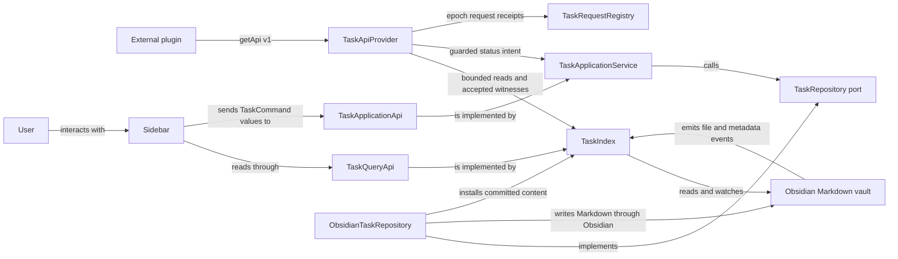

# Architecture

Abyss Tasks manages Markdown tasks through an Obsidian sidebar, with task lists, a calendar,
project views, and Analysis. Markdown is the durable record. The plugin builds read models over
the vault and writes user changes through application commands.

## Provider connections

Main owns `ProviderSecrets`, `ProviderConnections`, and one `NativeProviderTransport` shared
by the explicit OpenRouter, OpenAI, and Anthropic SDK factories. Credentials live only in the
host's vault-scoped SecretStorage under four fixed plugin IDs. The settings section submits
masked, initially empty inputs on Enter or blur, clears successful submissions, and reports key
presence without claiming connectivity. Neither rendering settings nor constructing a model sends
a request. `commandMode` holds only static provider/model/search/voice preferences; unknown
extensions remain intact through the ordinary settings coordinator. Persisted preferences remain
unvalidated `unknown` data until `parseProviderSettings` succeeds at the provider-use boundary.
Unsupported values do not block calendar startup; settings retain them until an explicit field
correction. Only an absent setting receives composition defaults. There is no prior AI data
format to migrate, and older plugin versions can retain the additive settings.

The native adapter admits two requests and eight queued requests. Cancellation and a 60-second
logical deadline reject local acceptance; an active slot remains occupied until `requestUrl`
settles. Queued cancelled work never starts. JSON requests are capped at 4 MiB and accepted
buffered responses at 8 MiB. OpenAI transcription alone accepts the pinned SDK multipart shape
(`gpt-transcribe` and one nonempty file), at most 4 MiB of audio plus 64 KiB of multipart overhead.
Validated parts are copied before queueing, encoded with the native Fetch boundary, and rechecked
for cancellation before requestUrl admission. Host buffering occurs before the response check. Streaming is
rejected. Fixed official initial endpoints prevent arbitrary source-page requests, but the host
follows redirects and offers no redirect isolation or physical abort. Typed safe failures omit
raw provider messages, request bodies, and credentials. Search selection can reuse OpenRouter
or OpenAI, or select independent OpenAI/Tavily billing; Anthropic has no implicit fallback.
Voice defaults to disabled and has an explicit OpenAI connection preference. These settings do
not start research, transcription, or an agent session.

## Command sessions

Main's `getCommandSessionOwner(research?)` lazily composes one `CommandSessionOwner`, public client,
provider-backed agent and local store per plugin instance. Panels and popouts share that owner.
The mandatory-journal `createCommandSession(journal, research?, transitions?)` factory remains
available for internal integration tests; a main-owned set releases disposed runtimes instead of
retaining one unload closure per archived conversation. Construction/opening does not parse provider
preferences or send requests. Main always supplies its `commandResearch` port, backed by
`ProviderResearch`, through a live delegate; an owner opened before configuration uses corrected
settings on its next deliberate request. The adapter parses current preferences per call, uses the
shared native transport and SecretStorage, and sends only the bounded query. OpenRouter requests
Exa through the pinned SDK plugin; OpenAI explicitly invokes hosted web search; selected Tavily uses
its fixed search endpoint. No fallback or page-fetching loop runs. Trusted interpretation admits at
most two research calls per turn. Each SDK call permits at most two network retries inside one
45-second deadline and the enclosing 180-second turn. Logical invocations and physical retries are
different counts. Output retains at most five validated HTTP(S) sources and 12,000 serialized
characters, separating generated summary from nullable attributed excerpts and marking truncation.
Cancellation rejects late output without claiming physical cancellation of host requests.

`CommandAgent` retains the SDK's bounded tool loop. Its model projection includes exact typed task,
comment, project and note references; these are issued handles, never aliases or fuzzy title matches.
Reference failures return the current canonical choices without changing the rejected operation.
A saved-tree read without explicit paging uses the same bounded canonical reader as proposals;
large results retain paged disclosure. Comment rewrites use the current owner-bound comment handle.
Intent-specific disposition validation distinguishes continuing work, resolving a pending transition,
and leaving a session. Archived sessions settle active planning status and clear accepted control
input while retaining genuinely unsent text and complete exchanges.

Project creation is a typed requested-values proposal. `CommandProjects` projects it into the
existing native header without manufacturing a saved DTO or path. Public schema checks cover explicit
fields, status and date ranges; dispatch rechecks the captured schema and invokes only
`ProjectsApiV1.create`. Templates and unprovided defaults remain native creation behavior. Receipt-bound
readback establishes the saved project and current focus. Explicit project membership moves use
`ProjectsApiV1.moveTask` with a reviewed complete root and destination header. Its receipt proves root
continuation only, so selected descendants or overlapping pending edits retain a concise conflict.
Late descendant selection retains that conflict through confirmation; selecting the exact moved root
resolves it. The write owner rechecks current focus before admission, independently of preparation.
Both operations use the shared admission journal and unknown-effect replay prohibition.

`ProviderTranscription` uses the pinned OpenAI transcription adapter through that same transport and
current SecretStorage/preferences. It returns final text only; the SDK exposes no portable confidence
score. Two SDK network retries share one 45-second transcription lifetime, without resubmitting a
command. Empty recognition and incomplete capture never enter the command queue.

Each mounted Q owns a `CommandVoiceController` and `NativeVoiceCapture` in its document/window.
The existing microphone, Enter and send finish one manual utterance. Continuous mode is a semantic
session choice, retained in local history with manual as the default; selecting/restoring it never
starts an idle microphone. A deliberate click claims the owner's exclusive capture lifetime. Local
RMS samples separate utterances after 800 ms of quiet. Silence stays local; five-second quiet
containers are discarded only after current quiet, preserving speech that starts at the boundary.
Each segment has a fresh supported WebM/Opus or MP4 recorder/container on the same stream.
Recording stops at one minute or 4 MiB; at most two segments await recognition. Activity alone does
not cancel agent work.

Final accepted text uses the existing surface submission token and owner queue. A transient capture
predicate binds the session, focus identity, transition, and actual composer-edit generation, and
is checked again after queued work settles. Composer edit/draft provenance belongs to the shared
session and is exposed through its owner. Every explicit edit invalidates earlier input captures,
including identical bytes from another surface; accepted turns and internal clears do not.
Restoration derives draft state from retained input and retires captures even for the same session
ID. Post-submit clearing uses that same shared predicate so it cannot erase another surface's edit.
Proposal revision changes retain the captured revision
for semantic consent checks; proven focus continuations from canonical refinements and receipts
remain usable. The predicate stops checking after admission so a spoken command may deliberately
change its own focus. Unsafe text in the same live session is retained after the exact typed input
with a blank-line separator and one review status; it is never submitted automatically. Audio,
media activity and those predicates never enter history or model context. Hide, owner/session
retirement, pagehide, media loss and unload stop tracks, local processing, timers and late results;
reopening retains the conversation and mode. Typed input remains available on failure.

`CommandSessionOwner` owns visibility, coalesced ordinary persistence, serialized external session
selection and direct status actions, and disposal. `CommandSession` owns input, focus, proposal,
typed pending disposition and recovery state. Switching reuses the client; inactive sessions are detached JSON records. The owner
flushes ordinary state at command/lifecycle boundaries and after a 250 ms scheduler delay. Required
write admission and receipt saves bypass that delay. Storage failures appear as one short surface
status, with safe diagnostic codes when opened; startup raises no history Notice.

Q mounts `CommandModeSurface` through `CaptureSurface`'s extension port. `CaptureSurface` keeps
IME, wiki completion, Enter/Shift+Enter, held-key suppression and detached-menu interaction
ownership. Only Q uses the multiline adapter; ordinary capture removes CR/LF before its existing
controller receives input. Command input never follows ordinary capture's blur submission path.
Main retains transient mode/selection/scroll memory and the shared owner; destroying or migrating
a surface releases its Components and subscriptions without discarding the session. `CommandNotes`
adds focused note pages and exact NotePlan before/after ranges to that same retained canvas through
`RetainedTaskText`. Note and Q description/comment comparisons opt into an owned, hidden native
rendering of previous Markdown with the same field presentation, then use the same rendered diff.
Current comparison failures reach the caller's visible failure boundary; cancellation retires the
temporary owner and suppresses late failure output. Title/search comparison paths are unchanged.
Note body checkboxes are
visibly disabled; links keep their exact source context. Multiple edited ranges remain fields inside
one note card. Pages retain scope, continuation and exact source path across finish/remount;
partial pages never claim to be full notes. Note links share the navigation-only unresolved-link
guard. Note-only Enter uses the same proposal/journal path, and fresh receipt-bound section reads
replace edit previews after saving. Task/project rows keep their native identity during note updates.
Owner-backed note confirmation requires successful rendering of every pending note field on the
surface that initiated the submission. A disposable surface token binds a runtime predicate to
that exact submission/turn and session/proposal revision; another surface's readiness cannot
authorize it. Pending replacements, failed rendering and disposed registrations block Enter,
Save and semantic confirmation while editing remains available. Only an already interpreted
immediate-write request bypasses this display requirement. Headless internal sessions keep their
explicit confirmation contract. These predicates and tokens never enter history or model context.
The focus-transition menu captures its initiating token, session/proposal revision and exact pending
transition when opened. Its Save and continue action checks that basis after queued work settles
and passes the same note-review predicate through the existing save-and-focus route. A retired or
stale menu cannot approve a different proposal or destination; semantic transition saves retain
their turn-bound predicate.
Note previews yield to readback only when the accepted receipt matches its plan, revision,
provider and request, and the page matches the resulting note target/revision and exact selection
request (including the freshly minted edit section). Continuation retains that request. A later
requested complete full-note read of that exact accepted version also covers the changed selection;
partial pages retain their scope labels and cannot replace an edit preview outside that selection. A committed
write with unavailable readback retains the proposal as unverified evidence; old same-path pages
never become current merely because a write committed. This uses existing receipt/page fields.
Hide and Stop
cancel future planning through the owner, while an admitted write settles through its existing
journal. UI input/submission generations prevent late completion from clearing newer text.

`PanelView` refreshes bounded read-only view/inspector context on activation and submission.
Accepted saved task navigation uses main's internal `TaskApiProvider.nativeTaskTarget` resolution
through the existing identity owner, retained revision and current disclosure checks, then the
native inspector selection path. Automatic Saved feedback updates the inspector in place without
switching the compact pane. An explicit ready-finish reveal is transient, bound to the verified
saved target/revision and current turn/session, and must be claimed once and acknowledged by the
native view before the agent can report completion. Cancellation invalidates late acknowledgements.
Titles and source coordinates grant no navigation authority.
Draft checkboxes use the owner's serialized `stageStatus`: new nodes append initial status to the
exact canonical plan; existing and copied nodes retain a separate lifecycle status intent. Saved
checkboxes use `applyStatus` and do not commit unrelated proposals.

`CommandSessionStore` owns a version-1 local history envelope through main's synchronous
`App.loadLocalStorage/saveLocalStorage` port at `abyss-tasks:command-sessions:v1` and an explicit
clock. Record saves and active selection are separate. `commandRecovery` validates complete
snapshots, public domain DTOs/receipts, typed preparation inputs and retained review evidence.
Malformed or future storage pauses persistence without overwriting its raw value. Save failures
retain validated memory and reject the awaited journal. Writes require exact validated readback;
the host port provides no crash transaction guarantee. Session history never enters settings or task
Markdown.

History retains complete exchanges and authored fields. The soft policy is 20 completed sessions
and 2 MiB of UTF-8 JSON, pruning oldest eligible inactive records only after verified persistence.
Active, pending, uncertain and unverified-save records stay protected, including during explicit
clearing. Protected overflow fails without truncation. Entity read caches remain separate from
intent/proposal evidence and are retained exactly; the store does not discard selected evidence
under pressure or own a live session/client cache.

`CommandSession` publishes detached immutable state: input, focused entities, canonical trees,
proposal revision, complete exchanges, question, status, actual readback and write journal.
Every nonempty submission goes through semantic interpretation. Empty submission confirms the
current proposal deterministically. Model confirmation is bound to the session and proposal it
saw, before any external reads; delayed submissions can carry the same explicit basis. A ready
preview needs no question. Only missing information or a conflicting instruction blocks confirmation.
Task creation previews by default, and persisted status uses the ordinary guarded lifecycle.
Saved-row status actions leave unrelated content proposals pending. Project refinements merge field
assignments by field ID and retain omitted status/fields; explicit null clears remain distinct.
The original accepted project revision remains guarded across those refinements.

Explicit working selection is separate from background reads. Optional typed `finish.selection`
selects up to five verified entities; omission preserves selection and an empty list clears it.
The session verifies the entire selection before publishing, including exact plan/revision for draft
nodes. A uniquely owned opaque draft target can resolve its current plan internally; supplied
node/plan revisions must still match, and ambiguous overlapping plans require an explicit plan.
An exact pending-removal subject is verified against the canonical before side of its current
plan; this retained review selection does not grant mutation authority. Surviving nodes use the
after side. Refinement retains selected node identity; saved focus continues only through receipt
correspondence and readback. Deleted or unverified affected selections leave current focus while
historical entity and journal evidence remains. Project/note readback updates selected revisions.

An unrelated focus change with pending work retains a typed target and asks for save, keep, discard
or cancel. Same-tree focus and added context preserve the existing workflow. Menu and semantic
session changes share these transitions. Dispositions and confirmations bind to the accepted
session/proposal revision; changing the pending target advances that revision. Save-and-switch
awaits the verified previous outcome, and save-then-plan leaves the subsequent tree as a preview.
Keep retains the complete unsaved draft in history without a source write; discard requires explicit
abandonment. Ambiguous disposition retains work and asks a short question. Legitimate transition
questions terminate normally instead of consuming tool-repair attempts.

Reloaded handles are historical. Opening preserves input, question, exchanges and canonical trees
without replay. The still-owning runtime can resume task-only plans after public refresh proves
unchanged canonical values; other or expired plans require explicit fresh review. Review retains the
logical session ID and original proposal/focus/preparation evidence, clears old executable proposal
state, advances its revision, and publishes fresh preparation for renewed confirmation. Preparation
records and historical DTOs are context, never source identity authority. Model tools remain
read-only for historical or uncertain sessions until the appropriate transition. Unresolved
admission, partial/unknown resource effects, and a receipt saved before proposal clearance remain
protected. Journal origin distinguishes direct status actions from proposal admission; older evidence
without that discriminator remains conservative. A verified direct status change leaves a separate
pending draft eligible for fresh review. Explicit acknowledgement can archive uncertainty and start
independent work without claiming success or allowing replay. That acknowledgement is retained with the unresolved record,
so revisiting its history does not require acknowledging it again; it never changes write blocking or
pruning protection. History selection checks the same acknowledgement boundary as new-session.

`CommandAgent` runs the SDK tool loop with generic required tool calls, serial execution, bounded
steps and generation deadlines. Active tools enforce the interpretation phase; a typed finish
is the only accepted terminal ready/question result. The loop has
application-owned network retries and separate schema/domain repair limits. Provider-facing schemas
use explicit object roots with nested discriminated requests; branch requirements and extra-field
rejection remain enforced during execution. Ready/question finish uses a small explicit object
with the original union validation. Main supplies local
civil time and timezone. `commandSchemas` validates executable arguments and outputs, preserves
unrequested authored title annotations, and bounds model-facing projections. `commandReads`
recovers only typed incomplete readonly coverage through bounded publication waits. Full-tree
pages remain separate from the changed-node proposal budget. Model context excludes the durable
write journal and duplicate historical trees; current plans retain their exact native refinement
basis. `CommandReferenceBook` projects at most 4,096 short typed references per SDK run and decodes
only declared reference fields through `commandReferenceShapes`. Authored text stays untouched.
Unknown, wrong-kind and previous-turn aliases fail before an operation; exact stale revisions still
reach the native revision checks. Each run owns its book, and session state, history, consent,
preparation records and writes keep canonical handles. Current observed revisions supersede older
reference-catalog pages, while same-revision comment pages can be combined.
An unresolved non-create task failure cannot be cleared by creating a replacement root in that turn.
Unqualified live draft tree reads reuse the session's exact, uniquely owned proposal basis; explicit
plan/side/cursor selectors are never replaced. Reads return their declared cursor query, and large
complete-tree exploration falls back to a truthful bounded page.
Same-plan batches prepare at most 20 operations against concrete nodes present at the
initial revision, then stage the whole validated result and count every operation. Failed
preparation retains the earlier committable plan. Version-scoped comment edits remain separate.
Canonical before/after capture is bounded at five seconds, 4,000 nodes, 512 pages and 4 MiB of
projected scalar text across both sides. Incomplete capture leaves the earlier proposal intact.
Changed-node accounting matches retained native handles, includes cleanup/link dependencies and
does not charge shifted unchanged siblings. Refreshed plans use the same complete capture before
reviewed-value comparison. Current view context never implies an additional source restriction.

`commandWrites` sequences public facade operations and awaits journal persistence before every
effect. Cancellation is checked again after that save and before dispatch. A dispatched facade
call uses the run's independent settlement signal, so new input or hide stops only unissued
operations; native request deadlines, revisions, source checks and disposal still apply.
Known receipts and exact accepted readback precede Saved. Partial or unknown effects stop
replay and retain the draft and observed entities. Project-first writes can refresh a dependent
plan only when its complete reviewed values remain unchanged apart from proved identity/source
line relocation and observational clock values; source paths remain compared. A refresh drops
merge preservation; dependent cleanup
then needs renewed review. Source cleanup otherwise requires the exact covered assessment and a
known destination receipt/readback. Linked note creation freezes the path, task field and template;
after the note receipt, only a host-generated exact-destination link fills that dependency. Same-plan
refinement carries a link only through the verified original target/field/path and retained exact
placeholder, preserving newly reviewed surrounding text. The link tool accepts either a current
task plan/revision or an exact saved task target/revision. The saved branch verifies the complete
current owner, retains that validated read without changing selection, rejects overlap with a pending
root/child plan, and prepares its single typed edit through the existing task facade. Initial edit
paint proves the exact requested node and revision inside the canonical before-tree, including child
targets whose plan is rooted above them. It stages no preliminary comment and preserves authored literal
placeholder text. Comment links bind a current owner and
version-scoped comment handle; new comments are proved by canonical owner/order and count. Safe
same-plan refinements carry that handle only through complete unchanged ordered comment values,
never a prose match. Materialization uses the current exact comment handle and the host-generated
link to the actual collision-resolved note path. A later task failure retains the saved note and
reports the partial outcome without replaying creation. Deterministic dependency checks precede
every effect batch; incompatible refinements need renewed review before any note is created.
Current task readbacks are keyed by verified root identity. Lifecycle deletion removes the old root;
retained/recurring nodes and affected ancestors are reread through accepted parent handles.
Known write paths retire older observed task pages, preserving unrelated-source reads; selected
peers from an affected source are refreshed through their accepted handles before Saved. An
unverifiable selected continuation is reported unavailable, not presented as current metadata.
Intermediate plans and receipts remain in the journal, not appended as current task versions.

Hiding retains input, question and proposal, cancels pending model acceptance and queued turns,
and stops future admission. Admitted writes settle and are read back, including when receipt
persistence fails. A storage failure before admission records known unchanged effects locally and
admits no native write. Disposal flushes the available snapshot and revokes the old owner's storage
callbacks before releasing its client after admitted work settles. A later receipt may therefore
remain historical uncertainty across unload; the old owner cannot overwrite a replacement's history. These modules consume the public facade and do not acquire native
storage writers or introduce an additional transaction engine.

## System at a glance

Queries return detached, immutable snapshots. Commands validate current source, perform writes,
and return structured outcomes. Successful writes enter the read model before the command returns;
later vault and metadata events reconcile through the same parsing path as manual edits.

[`TaskEditPreparationApi`](src/tasks/application/TaskEditPreparationApi.ts) prepares a root tree
without writing or publishing accepted revisions. TaskApplicationService freezes settings and clock
and normalizes typed edits through its ordinary command preparation. Immutable `append` operations
use refs from the preceding `after` tree; `before` remains the original accepted root, and `after`
is null only for deletion. Returned snapshots and receipts are detached.

[`MarkdownTaskEditPreparation`](src/tasks/infrastructure/markdown/MarkdownTaskEditPreparation.ts)
retains candidate content behind opaque commit closures and invokes the repository's existing
canonical codec/editor path in memory. ObsidianTaskRepository borrows accepted source evidence
through the index read ports. Inside the existing file writer it checks the native file identity,
accepted source version, original full-file bytes and root revision, scope, semantics, and candidate
source policy. Any intervening same-file edit rejects that writer basis. One commit attempt writes the
complete candidate and publishes through the normal transition path; root deletion uses normal
delete receipts and configured empty-note cleanup. Composite edits carry canonical physical line
mappings through each append. TaskBlockEditor proves insertion/removal continuity from retained
source-line objects, including identical-title siblings; missing proof never becomes a continuation. Repeated commit calls retain the first result, including unknown failures;
recovery reads do not replay the edit. An unattempted plan family can instead `refresh` against
current accepted state. The application and repository require exact or native authority continuation
of the retained root, unchanged original root bytes, the same native file, and unchanged settings,
scope and semantics. The canonical block editor transplants the sealed replacement into the fresh
note, preserving other bytes. Refresh advances a private writer anchor while retaining the original
reviewed `before`, frozen clock, and composed child map. Any attempt, including an unchanged or
unknown result, prevents refresh throughout that append/refresh family.

Preparation-only `refineInitialStatus` uses the frozen application clock, settings and status
catalog. The native owner certifies authored nodes from canonical creation or a complete, injective
single-child insertion map and carries that provenance through physical correspondence. Original
and copied historical nodes cannot use construction status. Accepted status commands retain their
ordinary recurrence, tracking and completion-deletion lifecycle.

[`TaskSourceCopyApi`](src/tasks/application/TaskSourceCopyApi.ts) adds source-selected comment and
subtree copies to sealed root preparations. Copy and assessment await the existing guarded source
acquisition, then capture an exact accepted source; a task tree alone need not retain full note bytes.
[`preparedSourceGraft`](src/tasks/infrastructure/markdown/preparedSourceGraft.ts) reuses canonical
comment ownership and hierarchy extraction, prefix adjustment and strict cross-file reference
rebasing. Callers supply refs, never Markdown or timestamps. Copied tasks receive fresh draft
identities and separate captured-source provenance. Whole-source bytes remain frozen through an
eligible destination refresh even when an unrelated source sibling changes.

The canonical editor supplies original physical line maps for copy preservation and exact original
comment continuation. Later edits retain a witness only while its captured range and ownership
remain proved. Same-root comment removal can use that continuation after copying, including
identical comments; cross-root removal remains an independently guarded command. Scope and
semantics are checked when preparing, delivering and committing copies. Source freshness is a
separate cleanup condition, so a changed source does not erase a valid reviewed destination copy.

[`taskMergePreservation`](src/tasks/infrastructure/markdown/taskMergePreservation.ts) inventories
canonical source header spans and owned body regions against the candidate. Simple flat merges
require retained title/description and header values, intact comment/child copies in source order,
and complete region coverage. Unknown fields/body data, conflicting lifecycle values, recurrence,
tracking and source identities hold cleanup with reasons. Anchored comments and unproved container
or cross-file reference transformations cannot be copied. Source title metadata that the canonical
model cannot classify remains a cleanup limit. The report is evidence at one candidate, not a
transaction or permission to delete: consumers still require a known destination receipt and
readback before separately guarded source removal.

Cross-file description assessment uses the same strict source-reference scanner as native source
transfer. Links, embeds, images and unclassified reference syntax hold cleanup without an equivalent
destination proof; code literals remain ordinary description data. Editable-link parsing grants no
preservation evidence.

Canonical single-root edits and task insertions also prove untouched sibling roots from their exact exterior bytes and
physical line displacement. The repository validates their accepted revisions and passes them through
the existing TaskRefAuthority transition and occurrence witnesses, including duplicate full blocks and
children. TaskIndex can use the latest native unchanged-revision witness across missed intermediate
shifts only for positive, unique, non-recycled generations in the same authority epoch. Generation-zero
source-derived revisions require refresh after every shifting write. Visual, uncertain and text-only
relocation results do not grant refresh authority; no historical transition store is retained.
Same-revision native transitions remain relocation evidence with an explicit authority-transition
basis, preserving ordinary archive behavior and keeping `authoritySuccessor` limited to changed
generations. Refresh requires that native basis, never the relocation label alone.

Ordinary and prepared task creation reuse `ProjectRootPhase` and its full-population structural
reservation. Canonical insertion retains all untouched roots and descendants by physical source
correspondence, including duplicate blocks under prepend and section placement. A created receipt
uses the structural owner's fresh reserved root reference; an unavailable accepted installation cannot
make an equal preexisting root look like the inserted occurrence. Acknowledged storage remains a
known commit even if later accepted readback is unavailable.

A rejected staged write cannot retain speculative sibling or inserted-root authority. Exact rejected-candidate
readback remints retained sibling and newly inserted revisions without continuations and publishes their invalidation
through the existing occurrence boundary. Literal restoration ownership remains reserved for the
original source. If rejection readback is unavailable, the repository captures a native file and
observation guarded invalidation from TaskSnapshotState. The index revokes speculative task refs,
marks source acquisition failed, and retires occurrence handles; it does not certify an empty note.
Later acquisition cannot reuse the revoked refs. Creation additionally binds the invalidation capture
to the exact candidate content, so an already accepted competing source cannot be invalidated by an
older failed write. A later accepted observation also makes a captured invalidation inert.
The structural owner's optional rejected-readback path retains only its existing restoration or
revocation stage through installation/release. Revocation stages cannot forward bytes, complete a
mutation, or commit authority. Changed-generation status successors keep their established confirmed
receipt behavior; rejected insertion revokes its fresh root as well as retained siblings.

[`TaskCreatePreparationApi`](src/tasks/application/TaskCreatePreparationApi.ts) prepares complete
new trees through the same application normalization, canonical creation codec, editor and snapshot
projector. Seed children receive native prefix/Inbox policy and initial lifecycle/status fields;
initial status constructs the task through the shared line codec without completion-time deletion
or recurring completion. Descriptions, comments and their timestamps are visible before provisioning. Appends retain sealed candidates and expose detached
physical node correspondence from the immediately preceding preview, including newly drafted
children with identical titles. Changing previews have distinct draft revisions; unchanged appends
retain the preceding snapshot and refs. Draft refs carry no accepted mutation authority. A creation
starts with no predecessor map; root deletion discards the proposal rather than becoming a creation
command.

Destination planning remains read-only. The sealed plan captures effective behavior/catalog,
resolved default path/insertion, native file identity and accepted bytes, or a missing note with a
frozen static template. Pre-provision checks include project guards and complete candidate source
policy. Each provisioning boundary rechecks the captured basis; insertion rechecks identity, bytes,
settings, project revision, scope and semantics inside the existing queued writer. A changed default
never redirects an agreed candidate. Commit inserts the exact reviewed block once, shares its receipt
across repeated/concurrent calls, and reports destination provisioning separately as unchanged,
committed or unknown. A persisted folder/note with a failed task insertion is not a saved task.

`NoteTemplateService.planStaticNote` owns guarded static provisioning through its existing folder
and note writers. It freezes core template expansion during preparation and rejects executable
Templater syntax before any writes with `unsupported-template`. Existing destinations need no
template execution. Ordinary Q capture retains its established eager preparation and Templater
behavior. No new text-write authority or persisted task metadata is introduced.

Creation refresh coordinates the repository basis with `TaskDestinationPlan.refreshPrepared`, the
static note owner, and the selected project guard. It keeps path, insertion policy, template bytes and
expansion, settings and project meaning fixed. Project guards can adopt incidental task-byte revisions
only while identity, frontmatter, membership/schema semantics and placement remain unchanged.
A planned missing note can adopt a newly created file only with a current accepted root anchor.
`sharesDestinationBasis` compares preparations issued by the same application owner through private
sealed destination/template state; it exposes no template bytes and proves no write success. Its inward
caller must retain the earlier known successful creation, verify matching destination bases and proven
current occurrence identity before supplying that receipt's anchor. Native owners validate the anchor's
accepted reference/path/file; they never infer success from a file appearing. Static note refresh then
binds the accepted file and makes provisioning a no-op. These capabilities add no public receipt token,
identity registry, command replay or multi-root transaction.

The opt-in native profiler in [`tooling/performance/native-api.ts`](tooling/performance/native-api.ts)
is a structural consumer of the external v1 contract, imported only as types from `api.d.ts`.
Its scan measures complete coherent pagination after untimed client activation. Its status span
measures one guarded completion, identical receipt replay, and final hydration after untimed
sandbox creation through the existing application command. Preparation waits for matching metadata,
current and cached bytes, and canonical acceptance before one fresh public resolve. This establishes
the sandbox read basis without reserving coverage against later host events. Ordinary profiling never
discovers the provider. Both selections use the same profiler, pending-work drain, cycle reset, and
transaction restoration; the API client and listener belong to one cycle.

The profiler's opt-in `single-note` fixture supports separate common-command and feature-facade
rosters. `native-command.ts` uses existing application commands for the former and type-only public
contracts for sealed preparation/apply and prose-section measurements. `native-note-search.ts`
measures complete-source search, cursor continuation, resource refusal and exact paged reads through
the same facade. Feature modules acquire no product source adapters or session-history owner;
ordinary and original-product profiling can bundle the final tooling without candidate runtime
imports. The existing native observation, pending-work and transaction owners cover these spans.
The diagnostic window observation borrows only the captured renderer's native window, proves its
hidden state, and restores it before pending work drains. Renderer CPU attribution binds sampled
script identities and coordinates to an exact full-bundle interval read through the owned CDP
session. Evidence records the debugger source URL and captured CPU resource URL separately;
only the latter is used for mapping. A script URL alone cannot authorize source mapping.
Failed note receipts collect source conservation and retained-target outcomes through the existing
facade after failure. Measured operations do not replace product read or reconciliation methods.

## Sources of truth

| Concern                                                 | Authoritative source                                         | Derived or temporary state            |
| ------------------------------------------------------- | ------------------------------------------------------------ | ------------------------------------- |
| Tasks, planning, comments, recurrence, and dependencies | Vault Markdown                                               | TaskIndex snapshots and projections   |
| Tracked time                                            | Markdown time entry lines                                    | TimeEntryIndex and totals             |
| Project membership and fields                           | Project Markdown and configured membership/field definitions | ProjectStore snapshots and statistics |
| Static preferences                                      | Plugin `data.json`                                           | Composed runtime CalendarSettings     |
| Saved list, section, and project views                  | Versioned plugin `state.json`                                | Composed runtime CalendarSettings     |
| Navigation, selection, search, drafts, and gestures     | AppState or the owning controller for the session            | Rendered DOM                          |

`TaskIndex` and `ProjectStore` are rebuildable. `AppState` coordinates the interface and does not
persist it. Saved preferences remain separate from transient interaction state. CalendarMode owns
its date and view type; StatisticsMode owns Analysis choices for its session.

## Dependency and write boundaries

[`src/main.ts`](src/main.ts) is the task-system composition root and Obsidian lifecycle entry point.
It loads settings, builds the status catalog and concrete task adapters, injects capabilities,
registers views and commands, and starts and stops plugin services. Consumers do not construct
alternate task repositories, indexes, or Search services.

| Boundary                                         | Responsibility and dependencies                                                                                                                                 |
| ------------------------------------------------ | --------------------------------------------------------------------------------------------------------------------------------------------------------------- |
| [Internal task boundary](src/tasks/index.ts)     | Presentation's entry point for task queries, commands, capture, Search, Statistics sources, and task values                                                     |
| [Task domain](src/tasks/domain/)                 | Immutable values, identity, validation, status, recurrence, dates, and time; depends on itself, deterministic `rrule`, and shared tag syntax                    |
| [Task application](src/tasks/application/)       | Use cases and validation through domain contracts and application ports; no Obsidian or presentation imports                                                    |
| [Task infrastructure](src/tasks/infrastructure/) | Obsidian adapters, index, codec, source editing, and reference authority; depends inward, with explicit host, Markdown, scheduler, and search-engine boundaries |
| [Shared Markdown](src/markdown/)                 | Source syntax and display/search parsing; imports no task layer                                                                                                 |
| [Presentation](src/panels/)                      | Views and interactions over public capabilities; no task Markdown writer                                                                                        |

[`TaskApplicationApi`](src/tasks/application/TaskApplicationApi.ts) exposes commands and composed
query capabilities. [`TaskSearchApi`](src/tasks/application/TaskSearchApi.ts) separates shared
retrieval from canonical organization and exact hydration. Statistics has a separate retained-source
capability. Infrastructure never imports UI. [`src/parser/`](src/parser/) is a legacy presentation
adapter with a narrow codec-import exception; new task behavior belongs in `src/tasks/`.

Text writes have named owners: `ObsidianTaskRepository` for task transactions, `ProjectManager`
for project metadata, `NoteTemplateService` for note preparation, and `TagManager` for global tag
renames. Settings writes use composition-root ports. The exact file/owner/API authorizations and
the reasons for exceptions live in [`storageAuthority.ts`](test/architecture/storageAuthority.ts).
Passing data to a renderer or deriving a projection grants no write authority.

`NoteApplicationService.commitPreparedSection` owns one additional `Vault.process` acquisition
for prepared prose sections. Main supplies the existing per-file task queue and canonical task
protection. The writer checks the native file, full accepted bytes, source scope and semantics,
frontmatter, and the complete task population before returning its sealed candidate. Its native
adapter uses `TaskRefAuthority.reserveStructuralMutation` to preserve roots and children only
through an exact prose-range displacement. After forwarding that exact candidate, the adapter
temporarily defers prior metadata echoes through TaskIndex only while the accepted source instance,
native file and prior stamp, scope, semantics, and original reservation still agree. A different
metadata value or failed proof retires the deferral. Install, rejection, and release retire it
synchronously before readback; fresh candidate reconciliation remains required. This covers delayed
prewrite metadata without granting authority to external reversions or replacement owners.
Rejected or unreadable writes retire speculative
continuations through the existing restoration and invalidation paths.

## Portable integration contract

[`api.d.ts`](api.d.ts) is the canonical external contract, including discovery and cleanup
examples. Consumers inspect an integration-supplied candidate for `getApi`, request major version
1 explicitly, and check the result and `info.apiVersion`. Unsupported majors fail without fallback.
The contract does not prescribe an Obsidian plugin registry. Register client disposal and the
subscription's unsubscribe function with the consumer's own lifecycle. Read capabilities and limits
from `client.info`; they describe supported operations and bounded resources, not permissions.

External plugins and the command agent use this client boundary. MCP is not implemented.
`src/main.ts` alone composes the provider with the real index and application service. `src/integrations/` imports inward contracts through `src/tasks` and the narrow
[`projectApi`](src/projects/projectApi.ts) port; the task domain,
application and infrastructure layers do not depend on the external declaration or facade.

Content preparation exposes `set-initial-status`, revision-selected `copy-subtree`, exact accepted
`copy-comment`, and read-only `assess-merge` operations through the existing facade. Plans return
source/destination task and comment correspondence. Complete commit receipts map issued plan
comments as well as tasks through exact accepted candidate readback; historical replay does not
renew those handles. Comment handles identify an issued owner/revision-bound capability, so later
reads may issue different strings for the same comment. Copy evidence keeps the caller's selected
handle in `source` and separately issues exact source/destination pairs. A comment selection has
one pair. Receipt comment-handle capacity failure makes correspondence unavailable while retaining
the known storage effects. Assessments name their source basis and exact plan revision; every later
append or refresh drops the assessment. Model assertions cannot supply preservation coverage.

Optional `info.contentLimits` publishes actual accounting scopes: 128 retained versions per client,
a derived provider ceiling of 16,384 versions across 128 clients, five-minute family TTL, and 8 MiB
of UTF-8 JSON before/after snapshot accounting per client. A validated preparation input above
1 MiB of UTF-8 JSON is rejected before native preparation. Reads keep complete scalars. Task-handle
maps are capped at 50,000 per version side; each client tree reader shares 50,000 comment/time-entry
handles with 60-second expiry and pages cap at 500 entries. These snapshot and input limits do not
bound captured native source heap, and there is no new shared reservation registry.

The optional `notes.search/read/prepare/create/apply` facade uses the neutral
[`NoteSourceReadApi`](src/notes/NoteSourceApi.ts) over TaskIndex's existing accepted source store.
The project reader extends that same contract. Zero-task notes participate in source observation
and coverage. Opaque note and section handles retain identities and source ranges; write plans
retain their sealed bytes within bounded budgets. All mutations share `TaskRequestRegistry`,
including request IDs, admission, replay and retained receipts. Each delivery rechecks current
disclosure while receipts retain historical storage effects. `ReadNoteV1.linkFor` accepts either
an existing accepted source handle/revision or a mutually exclusive `fromPath` formatting context.
The latter validates a vault-relative Markdown path without looking up, reading or provisioning
that source. Destination permission and accepted-note checks still apply. Host-generated links
are parsed through the shared source-reference grammar and resolved natively to verify the exact
destination, including headings, blocks and Markdown-link preferences.

Canonical prose protection retains one immutable task-range result for the last exact content
string. Each section read still validates the accepted source and obtains fresh host heading/block
anchors. Note search receives the existing explicit-window scheduler from main through its internal
note port. Each client read owns cancellation for pending yields; caller abort or client/provider
disposal releases the scheduler resources and prevents late results. Source-count, character and
cursor limits and complete-source matching remain at the same scan boundaries.

Note search uses the host's `prepareSimpleSearch` against whole accepted sources in canonical
path order. Its per-call character target is 262,144, with one oversized source permitted up to
4,194,304 characters; larger sources return `RESOURCE_LIMIT` and remain available through paged
reads. Read pages preserve every selected character and keep transport fragments tied to their
complete section handle. Frontmatter and task blocks remain read-only. Heading/block selection
uses public host link resolution only with structure supplied by an exact accepted metadata event;
unproven caches leave plain note reads and safe prose gaps available. Canonical block ownership
and TaskIndex share `taskSourceListItems`, including fence and ancestor semantics.

Native source acquisition and task/project/template readback use `readVaultText`, preserving
`read` versus `cachedRead` scheduling. A UTF-8 byte-count/native-size discrepancy triggers
`readBinary` and fatal UTF-8 decoding with the leading BOM retained; fallback succeeds only when
raw text equals a single BOM followed by the original read. Contrary text raises a typed source-change
refusal; reconciliation treats that refusal as no installation and preserves native I/O rejection
routing. Initial cached-load recovery retains existing committed coverage only after a fresh exact
read verifies the same captured source, native observation and scope; it installs no stale cache.
Byte counts are not equality proofs. Owners retain and synchronously recheck their
original native file, stamp and policy after the helper returns. A normalized metadata event is
bound to raw text by exact equality or the verified single leading-BOM relation; `exactSourceMetadata`
validates and projects its coordinates before installation. Unproven/stale events grant no
heading/block authority. Append previews include a required existing trailing line separator
before a following protected block; commit writes that sealed result.

Prepared note creation freezes the static template and final prose through `NoteTemplateService`.
The additive create-only `collision: reject | suffix` option defaults to rejection for public callers.
Opted-in suffix selection checks at most 100 same-directory alternatives during preparation; its
chosen path is frozen and a later collision rejects commit. CommandMode defaults ordinary new notes
to suffix, while explicit exact-path intent can select reject. `notes.create.collision` advertises it.
`notes.prepare.refine` exposes current-plan refinement with the same target and a fresh opaque
revision. The facade validates the original plan, delivery observation and capacity before publishing
a successor atomically; failures leave the prior plan current. Edit candidates accumulate at most
20 disjoint original editable ranges within one accepted note revision. Append extends pending
section text; replacement corrects that section. `plan.sections` supplies independent complete
review fields, while top-level before/after contains their bounded enclosing source window. The
canonical protection owner maps unchanged task blocks through the exact piecewise displacements
and reserves one structural continuation stage for the sole existing `vault.process` write.
Frontmatter, scope, source and native-file checks still guard the complete candidate. CommandMode
routes repeated edits of the same accepted note through its current plan and refuses a separate
competing edit plan. Create-plan `replace-body` refinement reuses the captured static template,
title and frozen destination; it never reselects a path. Link dependencies retain the same note plan
target across revisions. Existing single-operation public forms and all prior resource limits remain.
Successful exact-range edits can return an optional `section` receipt reference, advertised by
`notes.apply.section`. The note owner proves accepted bytes, identity, meaning and current file;
the existing registry binds its known post-edit range to that fresh revision for readback only.
Unverifiable/concurrent results omit the scope and keep truthful written-but-unverified recovery.
Receipt redaction removes both note and section references after disclosure or revision loss.
These additive fields require no persisted migration; older consumers ignore new receipt fields,
older providers reject unsupported create arguments, and all versions still read ordinary Markdown.
No prior form is removed.
Its existing `commitStaticNote` remains the sole static creation sink and checks the final source
basis synchronously after asynchronous validation. Executable templates and task-containing
candidates are rejected before provisioning. Folder effects and note effects remain separate;
a later task-link failure never authorizes repeating a successful note creation.

The headless project read adapter derives membership and fields from accepted TaskIndex sources,
including empty notes, without opening ProjectStore. Main injects one reader, the ProjectManager
write port and the prepared project task commands into TaskApiProvider. Only this complete
composition advertises the six project capabilities and exposes the eight project methods.
Requests materialize project notes on demand. Clients share a provider-owned ProjectReadRegistry
for bounded opaque file identities and cursors. Project configuration invalidates common scans without changing task status semantics.
ProjectStore and the adapter share root statistics through the pure project statistics model.

Headless project updates run through ProjectManager's per-app metadata queue. The manager checks
the accepted file, source bytes, field bindings and status meaning inside the single-note write.
It validates membership and exclusion on the candidate before returning it to the vault.
Main also supplies the existing canonical task-protection authority. The frontmatter writer
reserves and settles a structural mutation only for an exact unchanged task body and population,
preserving duplicate-root identities through the metadata displacement. It remains the sole
project metadata writer and uses the existing continuation/rejection paths.
When a note has frontmatter, TaskIndex and the writer require a YAML mapping and verify its
boundaries against Obsidian after accounting for a leading byte-order mark.
For headless creation, NoteTemplateService prepares the configured static template and the manager
adds the initial fields in memory. The service rechecks the template, destination and project scope
after folder creation, then creates one note with its final content. This route accepts core static
substitutions and suppresses recognized automatic Templater execution. Executable templates and
unsupported active adapters fail before note creation. Both writers reconcile the
actual file through TaskIndex before issuing a new project reference.

Project task capture uses the dashboard insertion policy and the application service's task
prefix and lifecycle settings. The repository checks the project's file, accepted bytes and
candidate inside the native write. A root move uses the same destination-first sequence as
the dashboard. Before copying, it checks the source root and the permission of the note that
would remain. Before removal, it reads back the destination and verifies the installed copy,
current project membership and original source incarnation. Each phase records its own storage
acknowledgement. TaskIndex accepts structural occurrence witnesses only while the file and
acquisition still match the readback. The inserted root receives a fresh revision even beside
identical roots. The facade pins existing targets at admission and reserves capacity for a new
project or task. A confirmed task result names the writer's exact occurrence. A same-note move
uses the pinned original target. Summary evidence suffices for project writes and disclosure,
including projects whose configured detail exceeds the public result limit.

TaskIndex samples the native file identity, size and modification time at acquisition. A changed
stamp makes the accepted source unavailable. Ordinary metadata callbacks can update tasks immediately.
TaskIndex records when their bytes still need confirmation for a project reader. An exact project
read checks its own note. A page checks coverage across all potentially visible notes, including
those after the page boundary. A pending proof yields incomplete coverage. TaskIndex confirms queued
coverage paths one at a time, with a separate slot for exact reads and moves. Readers share a native
read of the same acquisition. Only an individually read note receives ongoing native checks.
Matching bytes confirm the source. Different bytes enter the
normal index installation and invalidate subscribers. A superseded acquisition cannot settle a newer
one. Project moves can wait for their captured source proof. Later callbacks for project-read notes
reuse the proof only when the bytes and stamp still match. Static template creation checks its captured
template stamp through folder setup and final authorization.

The declaration has no imports, runtime statements, ambient host augmentation, or internal type
references, and needs no Obsidian or DOM typings. Its request and result data is recursively readonly.
[`src/integrations/validation.ts`](src/integrations/validation.ts) accepts allowlisted plain
records, normalizes canonical task dates and tags through the task public boundary, and
copies and freezes validated data. Cancellation signals remain live caller-owned capabilities;
only their copied options envelope is frozen. [`values.ts`](src/integrations/values.ts) owns
plain-value freezing and structured API errors. Public integration calls return structured failures
without UI notices; ordinary task commands retain their existing behavior.

[`TaskIdentityRegistry`](src/integrations/TaskIdentityRegistry.ts) owns bounded, epoch-scoped
opaque targets and revisions for issued occurrences. It consumes accepted semantic witnesses
synchronously, preserves proven continuations, and retires uncertain or removed occurrences
without reviving their targets. Whole-root or semantics changes advance the public revision.
Projection allocates a node and its parent atomically; lookup does not renew idle expiry or grant
source permission. Pins preserve accepted operation authority, while reserved capacity guarantees
a next-occurrence receipt can settle even after disposal. Receipt claims reuse an already projected
next occurrence only at its currently proven address.

[`TaskCursorRegistry`](src/integrations/TaskCursorRegistry.ts) retains bounded query bindings and
next offsets. Cursors bind normalized filters, page size, generation, scope, semantics, and provider
epoch; replay does not extend expiry. Both registries reject live capacity overflow instead of
evicting issued state. Their only task dependencies are inward value types exported through
`src/tasks`. Their contents are transient and belong to one provider lifetime.

[`TaskApiProvider`](src/integrations/TaskApiProvider.ts) implements the full v1 facade over
`TaskIntegrationReadApi` and `TaskStatusMutationApi`. Main constructs it before index initialization,
exposes `getApi`, and disposes it before destroying the index. Existing `queries` and `tasks` fields
keep their application interfaces. The provider owns clients, identity, cursor and request registries;
clients expose frozen method tables, readiness, subscription and disposal. The first client activates
occurrence evidence and installs a synchronous accepted-event listener. That listener applies identity
witnesses before external invalidations. Outward publications retain their original listener audience
and drain in order across callback reentry. Every callback checks its registration and client lifetime.
Provider closure settles pending readiness and closes listeners before releasing its inward subscription.

[`taskApiReads`](src/integrations/taskApiReads.ts) snapshots validated inputs before yielding, checks
liveness and current source permission at delivery, and maps inward failures to sanitized API errors.
Cursor binding failures precede incomplete coverage. [`taskDto`](src/integrations/taskDto.ts) copies
only the public allowlist, including parent targets; no inward revision or source block becomes a public
token. Current exclusion precedes incomplete health for target reads, while lifecycle failure retains
precedence. Source health determines whether a snapshot can be disclosed; identity witnesses determine
whether an opaque target still names the same occurrence. Either proof can be unavailable independently.

[`taskContentApi`](src/integrations/taskContentApi.ts) composes the native edit, hierarchy and creation
preparations into optional public tree, prepare, apply and create capabilities. A client owns bounded,
expiring immutable plan versions and plan-only draft targets; native preparations retain the source,
clock, settings and sealed candidate authority. Before trees retain the original reviewed root.
The plan composes original-to-current native correspondence through each immediate-predecessor
preparation. Late expansion issues existing descendant targets from the pinned original-root proof;
new authored descendants remain plan-owned. Refresh resolves
the pinned original accepted root, or a same-consumer successful insertion retained by the request
owner with matching sealed destination basis. It advances an unattempted writer without replaying a
command. Prepared successors remain unpublished until the final delivery check. Rejected delivery
releases only its unpublished version; a visible refresh predecessor retires only when a successor is
published. Concurrent visible versions and separately admitted request pins retain their ownership.
A mutation consumes the whole plan family, including divergent versions and failed attempts.
Reorder operations use the existing block editor and exact surviving source-line witnesses.
The additive hierarchy preparation uses exact source and parent revisions and always supplies
before/after participating root views. Exact source/parent root continuations and the moved root
select this review forest; unrelated roots in the same files remain outside the public preview.
Its focused before/after subject is the same moved occurrence.
The native hierarchy owner captures candidates and line correspondence without reserving structural
write authority, retaining full file populations and continuations for proof. Confirmation revalidates the sealed source and candidate bytes before its existing
reservation, queue, transaction and compensation path. Every affected source must remain disclosable.
Hierarchy previews cannot be appended to or refreshed as ordinary content edits; callers prepare a
fresh exact hierarchy after resolving pending work. `CommandTree` renders the affected forest through
its retained native renderer, and receipt readback uses proven correspondence for every issued node.

Initial native edit preparation is asynchronous: the existing repository awaits the source owner's
current acquisition, then rechecks file incarnation, lifecycle, scope, semantics and exact root.
That acquisition returns its original observation and a current-proof guard; capture checks the guard
in its own synchronous continuation and retains it in the sealed basis. Creation and refresh recheck
the same proof after later read awaits and before using or publishing a candidate, so a new observation
cannot replace the original acquisition evidence across an await.
The application owner captures settings and commands before the await and rejects changed settings;
the facade revalidates the accepted caller revision and releases pins on failed preparation. Creation
and refresh use the same source-acquisition guard. Append remains synchronous over its sealed tree. A refresh
whose exact final read still matches its original native/stamp/scope/root proof can report
`source-incomplete` when accepted coverage is pending. The facade returns `INCOMPLETE_READ` and
retains the predecessor for read-only recovery after a public event; it never retries or installs a
new basis inside that refused refresh.
Initial status symbols resolve through the current complete native catalog; saved status actions retain
their separate lifecycle command path. Draft status edits are not part of the content command union.

[`taskTreeApi`](src/integrations/taskTreeApi.ts) projects canonical direct-entry order into detached
trees and owns revision-scoped comment/time handles and shallow expansion cursors. Entry limits never
truncate scalar text. Incomplete children expand independently, so exhausting a node cursor does not
claim recursive completeness. Activity summaries derive from the full tree at one explicit observation
time, independent of the returned entry window. Read-only time entries preserve their owning node.
Plan handles never enter the accepted identity registry. Late before expansion projects accepted
handles only within the unchanged original block proved at the current retained root address.

[`taskSearchApi`](src/integrations/taskSearchApi.ts) owns client search cursors, releases borrowed native
cursors on expiry/cancellation/disposal, and scans native retrieval batches through exact accepted
hydration before applying node filters. Field selection travels through the existing Search service,
worker validation and MiniSearch field selector. Existing UI defaults remain unchanged. Scoped tag
catalogs enumerate permitted accepted nodes and reuse canonical case-insensitive representatives.

[`taskContentReceipt`](src/integrations/taskContentReceipt.ts) is stateless. It compares the sealed final
block with the writer's exact installed occurrence and current accepted readback, then maps only the
final-plan task handles frozen at admission through canonical relative positions within that proved
block. The existing per-file reconciliation record also borrows the exact current installed file
incarnation and source bytes. Matching host echoes retain its native transition before or after the
notification flush only when that full basis and task population still match. Same-revision native
relocation proof survives a later echo; changed-generation predecessor authority remains available only
for its already queued delivery, then returns to the established visual-only lifecycle. Different bytes,
replacement files, restoration or revocation replace or clear the proof;
unchanged task lists alone grant no continuity. A missing readback or mapping preserves write effects and never authorizes replay. Comments
remain version-scoped; receipts grant no durable comment correspondence. Every initial or replayed
content receipt delivery checks current client/provider lifetime and disclosure of its retained task
handles. It returns a detached redacted projection when proof is unavailable, while the request owner
keeps its immutable historical receipt and effect facts. Delivery never repeats the writer.

[`TaskRequestRegistry`](src/integrations/TaskRequestRegistry.ts) owns bounded accepted promises and
terminal mutation outcomes across status, project and prepared content operations within one provider epoch and
consumer namespace. Exact normalized payloads include the operation and deadline. Project request bytes and content receipt/preparation reservations share a 4 MiB cap in addition to the provider's request counts. Task and project targets
and cursors have separate capacity and expiry accounting. The registry validates and
normalizes payloads before replay, then acquires an admission ticket only for new requests. A final
synchronous reservation check handles callback reentry and releases unused tickets. A transient
abort listener covers admission: getter observations precede the final client check,
and abort notifications update owned state without another signal getter after that check. The
listener is removed when the synchronous reserve/reject decision finishes. Accepted work
keeps its authority pin through settlement and retains failures as well as successes; client disposal
cannot erase it. A monotonic effective clock rejects expired payloads, and only expired settled
records free capacity. Provider disposal rejects new work and drops terminal state while accepted
operations finish. Each task status ticket pins the original public target and retains the exact inward
root, selected node and observation. Any authored recurrence field reserves one possible-next slot before
acceptance. The ticket releases both resources on rejection or settlement, including construction failure.

Project receipts retain storage facts and optional opaque references. Each joined call or replay
checks its own client and the current permission for each reference. A task reference needs a
proven occurrence and a permitted, well-formed source at issuance and delivery. A healthy source
can still disclose the task after it leaves project membership. A move records the destination copy
and source removal separately. A failed second phase leaves the acknowledged copy in place.

[`taskApiMutations`](src/integrations/taskApiMutations.ts) validates new requests against current source
eligibility, coverage, revision and status semantics, then submits one intent through the existing
application mutation queue. The service acquires the strict read lease inside that queue. The facade
neither acquires a second lease nor imports reference authority or concrete storage adapters. It claims
the reserved next target from exact final occurrence continuations before projecting result snapshots.
Receipt mapping preserves committed status and known next facts when tracking or snapshot projection
fails. After a successful changed writer settles, its transaction invokes the one-shot confirmation
returned by the strict guard. Normal accepted-index installation runs first. If observation closed or
publication failed, the callback retains only historical original/next facts from that exact candidate.
It cannot restore current addresses, clear lease failure, or authorize follow-up writes. Existing
accepted roles and later timer continuations take precedence. Rejected writers never invoke it, and
lease disposal makes retained callbacks inert. Replays retain the original values and effects; each delivery checks current disclosure proof
and strips unavailable DTOs without replacing them with newer task data.

Readiness means initialization completed; it does not prove complete current coverage. A failed
or pending source, including an empty note, can make an otherwise ready scoped read incomplete.
A coherent scan subscribes before paging, keeps the same normalized query and limit, and accepts
only pages from one observation with no intervening invalidation. Consumers restart after a stale
cursor or incomplete read. Physical child nodes match filters independently of their parents.
Authored IDs are exact lookup values and may resolve ambiguously; neither source coordinates nor
an authored ID replaces an issued occurrence target.

Successful readiness or a read does not reserve complete coverage for a later queued write. An
accepted request that fails unchanged with `INCOMPLETE_READ` keeps that terminal result for replay.
The consumer rereads and decides whether to make a distinct request with a fresh ID and revision.
Committed, partial, or unknown effects must not be repeated just to obtain a missing DTO; use a fresh
read and the receipt's recovery guidance.

Targets describe proven occurrences within one provider epoch and idle lifetime. They are not
durable IDs; a continued occurrence can keep its target while its whole-root revision changes.
Request replay is bounded and in memory, so it is not durable exactly-once delivery. `consumerId`
is a request namespace, not authorization. Strict writer checks protect the current file and captured
read observations; they do not lock the whole vault into a cross-file transaction. A committed main
write can retain known effects while timer work is partial or unknown. Consumers follow the returned
effect and recovery values and reread when needed, without repeating known committed work.

Compatibility is exercised by the standalone consumer fixture and public contract, validation,
lifecycle, read, identity, cursor, request and receipt suites in `test/public-api-*.test.ts`. The real
index/repository harness also covers empty-source health, ordinary/UI occurrence continuation,
strict writer callbacks and per-timer guards. Architecture tests enforce the inward imports and exact
storage owners. Native desktop acceptance and the opt-in API profiler check the running host;
constrained desktop widths do not establish real-device mobile behavior. Product runtime remains
free of new Node/Electron imports and retains `isDesktopOnly: false`.

Main updates the effective mutation semantics key synchronously before settings persistence and when
the status catalog changes. The key covers the catalog, lifecycle date policy and recurrence settings;
unchanged effective values and unrelated preferences preserve it. Source exclusions continue using
the existing successfully persisted storage-policy hook. Reload creates a fresh provider epoch and
keeps old clients disposed. Public state, receipts and identity reservations never enter settings or
Markdown. The boundary adds no persisted fields or settings format changes, so it needs no data
migration. Rolling back v1 discovery leaves existing Markdown and settings readable.

## Task source and command flow

### Identity and reconciliation

[`TaskIndex`](src/tasks/infrastructure/TaskIndex.ts) discovers tasks from Markdown through the
canonical [`TaskMarkdownCodec`](src/tasks/infrastructure/markdown/TaskMarkdownCodec.ts). Host
list-item metadata enriches discovery; omissions cannot remove authored tasks. Source exclusions
apply before public projections, while excluded content remains available for repository proof.
Host-cache frontmatter supplies presentation values, with authored frontmatter as fallback.

Physical-root lookups derive source populations and first-line indexes from the installed roots.
TaskIndex retires these derived maps on installation, removal and disposal; they grant no identity
or continuation authority. Internal readers treat root source/ref fields as readonly, while public
projections and rename operations construct copies. Repository rollback captures its source-to-line
population map once per operation and retains the existing duplicate order/count checks.

Initial discovery starts after layout readiness. Vault reads remain concurrent, while each
initialization attempt owns a cancellable queue for accepting their results. The queue yields
between atomic file installations after a short time or work budget, rechecks file ownership,
and drains before publishing readiness. Retired attempts cannot accept late reads or failures.
Repository commits and metadata observations retain synchronous acceptance. One large file can
still exceed the slice budget; this is cooperative scheduling on the host thread.

`TaskIndex.integrationReads()` exposes internal lifecycle, coverage, and complete physical-node
reads. [`taskIntegrationProjection`](src/tasks/infrastructure/taskIntegrationProjection.ts) walks
canonical roots and descendants in code-unit path and absolute-line order. Filters apply to each
node independently; page hydration is bounded to requested rows and one lookahead. Exact addresses
retain whole-root revision and physical line offset, with parent lines calculated from full ancestry.
ID resolution counts all matches while hydrating at most 100. Ordinary root-filtered queries retain
their existing behavior. Read status uses the current catalog and authored cancellation precedence;
planning uses canonical valid date, time, and duration projections.

Accepted source records bind their existing evidence to the owned file object. Integration coverage
and disclosure require that object to remain at its current path; legacy ghost records and vanished
or replaced files grant no read authority. Disclosure also checks current source policy.
[`taskSourceMetadata`](src/tasks/infrastructure/taskSourceMetadata.ts) supplies authored tags and
frontmatter for that policy, separately from host-cache presentation enrichment. The projection
retains sorted path keys and borrows canonical node records inward. These records include internal
source and reference evidence; they are not external DTOs.

[`TaskIntegrationReadState`](src/tasks/infrastructure/TaskIntegrationReadState.ts) tracks source
acquisitions by file identity, initialization attempt, and current observation, including empty
notes. Pending or failed sources make reads incomplete within the requested path or folder unless
current policy proves exclusion from the path alone. Main supplies that proof from the existing
query parser and path matchers; unknown tags and frontmatter remain unknown through compound and
negated queries. Shared coverage applies the proof to scans, authored-ID resolution, and strict
status admission without hydrating excluded rows. Health remains tracked, so widening policy or
renaming into an included path restores the incomplete result. Arbitrary source predicates without
an explicit path proof stay conservative. Ordinary UI queries keep their existing empty-source
behavior. Accepted bytes settle only their current acquisition. Verified repository installs supersede older acquisitions, while previews
and rename relocation cannot clear unresolved health. Confirmed deletion and bootstrap pruning
remove health even when a file had no tasks.

Integration observations have their own revision, scan generation, scope revision, and effective
semantics revision, independent of Search and UI notifications. Policy refresh marks coverage
unsettled before awaiting reads. Subscription registration returns the current state atomically;
ordered notifications isolate subscriber failures and respect unsubscribe. Rename notifications
wait for synchronous canonical relocation and read admission, with coverage unavailable during
that transition. Counter exhaustion fails the integration read state with a sanitized diagnostic.
This capability reuses the index's accepted source records and does not activate Statistics.

`TaskIndex.statusReadBasis()` creates a temporary, operation-owned read lease for strict status
writes. The lease checks complete coverage, source policy, file identity, source observations, and
semantics. Repository guards run inside the existing synchronous writer before edits or no-ops;
strict requests cannot rebase or fall back to legacy arguments. Unsupported writer paths reject the
precondition. Ordinary commands retain their existing retries and result shapes.

`TaskApplicationService.mutateStatus` exposes a separate inward desired-state capability. It
reserves the existing dependency mutation queue once, admits an exact read lease, and dispatches a
guarded status edit without retry. Changed completion/cancellation operations use the existing
tracking service once, with the same lease, captured settings, and clock through every timer write.
Strict follow-up also captures whether the prepared main command lands on done or cancelled, so a
later catalog change cannot erase pending timers or turn an unfinished transition into a completion.
Ordinary follow-up continues to check the live catalog. Each edit requires the exact owning root and
node; a failed lease prevents further writes and
cannot acquire a successor. Semantic completion uses the
current status catalog and authored cancellation marker. The transient semantic transition intent
reaches recurrence generation and its completion stamp handling. Already-complete and exact configured
same-symbol requests still pass through the repository guard as no-ops. The service returns the
lease's final occurrence proofs before disposal. Main status results remain separate from tracking
details, which retain the last proven root, closed and unclosed counts, discarded entries, and
partial or unknown outcomes. The application captures pending timer counts before dispatch. If a
confirmed retained status write fails publication before tracking starts, it reports that skipped
work as partial; an unexpected failure after tracking starts reports unknown effects. Historical
confirmation never resumes timer writes, and removed originals and transitions without required
tracking acquire no tracking warning. A no-op status request does not close timers. Ordinary UI commands
keep their existing result shapes and follow-up behavior.

[`TaskStatusReadLease`](src/tasks/infrastructure/TaskStatusReadLease.ts) advances only from a trusted
operation-tagged acceptance of its exact pending full-source candidate. Repositories supply the
original and newly created recurrence owner coordinates before staging. The lease validates those
roles against accepted witnesses and follows them independently through timer edits, including two
occurrences in one root. Its inward listener runs before outward callbacks. It retains exact settled
acquisition tokens for its lifetime so delayed health notifications cannot invalidate already-proven
reads. Source health retains only overlapping acquisition cohorts until acceptance or invalidation;
a newer unconfirmed read grants no authority. An unrelated source failure stops later writes while
retaining unaffected occurrence proofs. Pathless source bookkeeping events revalidate only the
retained exact addresses against their accepted owner and current canonical roots. Later source
invalidation clears those proofs without following another operation's successors. Disposal releases
the subscription and pending bytes.

Occurrence collection activates synchronously on the inward read port. It retains no second task
index. Authority staging carries frozen continued, removed, and created witnesses with an opaque
operation token. Staging checks source-backed physical endpoints; acceptance checks their exact
canonical predecessor and successor addresses. Invalid or ambiguous evidence invalidates affected
addresses without claiming removal. Replacement file owners invalidate previous addresses even when
bytes match. Unchanged exact occurrences reserve their own endpoints and cannot be claimed by a
continuation from another occurrence. Duplicate echoes cannot recreate occurrences, and restoration
revokes forward semantics.

Ordinary task-line edits and comment/tracking splices carry physical node mappings from the editor.
The repository binds those mappings to minted candidate revisions before staging. Recurrence uses
its actual completed and active subtree coordinates: Keep continues every history node, Delete
removes every old selected node, and the next subtree consists entirely of created occurrences.
Ancestors and containing siblings follow the verified line transform. UI successor ordering stays
independent. Unsupported structural changes remain conservative invalidations.

Owned host rename preserves occurrence identity across exact confirmed content and rechecks source
exclusions. When policy or Statistics requires a reload, a transient rename operation borrows the
old canonical roots until its exact acquisition settles. It defers semantic disposition only; health
and existing UI timing remain unchanged, and old addresses are undisclosable while absent. Matching
bytes under the same file owner establish continuation before accepted callbacks. Changed, failed,
replaced, or superseded reads invalidate those predecessors and release the proof. External deletion
invalidates before callbacks; recreation cannot revive a previous owner. Unique byte-identical
same-file relocation reuses the existing reconciliation proof. Duplicate or visual matches do not.

Loaded observations, metadata observations, repository installs, and rename relocation share a
synchronous accepted-install boundary. Repository batches prepare and prove every file before
installing any roots. Once all roots and source health are installed, inward accepted listeners
receive exact accepted bytes, owned file identities, and settled acquisition tokens before held
health, Search, Statistics, or UI callbacks can read those roots. Previews publish no acceptance.
Nested accepted installations deliver their evidence in order to every listener. Integration reads
remain incomplete while newer installed roots await semantic delivery; the latest accepted event
can hydrate its own roots synchronously. Held notifications retain their acquisition evidence and
original listener audience; subscribers already advanced by acceptance receive the current complete
observation rather than an older
revision. Accepted source evidence is transient and never enters public task DTOs.

Edits preserve unrelated Markdown and identify the actual authored block or occurrence. Rendering,
matching text, file/line position, and link labels confer no write authority.
[`TaskRefAuthority`](src/tasks/infrastructure/TaskRefAuthority.ts) distinguishes occurrences and
records proven successors without adding identity metadata to notes. Each write requires a fresh,
unambiguous source match. Descendants retain their root and full ancestry.

The repository installs committed content before returning. A conflicting cache observation must
be confirmed by a fresh vault read before replacing it. Accepted reconciliation publishes a signal
even when tasks are unchanged or absent; `ProjectStore` waits for it before combining frontmatter
with task statistics. One failing subscriber cannot block other subscribers or that barrier.

### Commands and recovery

[`TaskApplicationService`](src/tasks/application/TaskApplicationService.ts) captures the clock and
behavior settings, validates commands, and delegates writes through ports. Conflict, invalid input,
missing or ambiguous targets, partial transfers, and I/O failures return structured outcomes.
The initiating presentation boundary reports them. A retry retains the operation's source proof
and policy; it cannot silently acquire a different target.

[`taskFileMutationQueue`](src/tasks/infrastructure/obsidian/taskFileMutationQueue.ts) orders
repository transactions, publication, and cleanup per App and path. Moves and archives prove the
destination before removing the source. Recovery compensates only exact content still owned by
the operation. Multi-note changes are not crash-atomic and can leave partial or unknown outcomes.
Archive batches retain a frozen destination and an outcome for content outside ordinary queries.

[`TaskHierarchyService`](src/tasks/application/TaskHierarchyService.ts) owns reparenting and
promotion. Same-note edits use one transaction; cross-note edits write the destination first.
Supported internal references are rebased; unprovable cross-note syntax is rejected. Inbound links
outside a moved subtree remain unchanged. Selection handoff follows the hierarchy outcome, not
line coincidence.

Explicit root deletion alone may remove an empty source note matching the current configured
`taskFilePath`, including valid historical date expansions. Other content, invalid frontmatter,
completion deletion, subtask deletion, and transfers have no such cleanup authority. Removal uses
Obsidian's deletion preference after fresh content and file-identity checks. The host has no
compare-and-trash API, so an external edit can still race removal. Cleanup failure reports a warning
on the successful task deletion; it does not retry or roll back that deletion. Undo cannot guarantee
recovery of a removed note.

### Capture and input

Capture owns a retained create session with destination, date, template, insertion policy, and
behavior settings. Planning and canonical previews do not write.
[`NoteTemplateService`](src/notes/NoteTemplateService.ts) prepares the destination at execution and
coordinates preparation of the same path. Uncertain preparation requires fresh proof before retry.
The application owns prefix, Inbox, and tag policy; presentation supplies typed input. Current source
exclusions still apply when a retained session writes.

Quick capture freezes its civil-time reference and smart-input preference on meaningful input.
The composition root injects offline English/Russian recognition and recurrence parsing through
`TaskInputServices`. Pure input models preserve raw text, manual choices, protected source ranges,
and occurrence-specific suppression. Canonical preview and submission share the same frozen policy;
recognition cannot consume protected Markdown or invent an authored title. Other capture surfaces
retain their existing capabilities. Recognition and draft state are transient.

A submitted request is frozen separately from newer input. Known unchanged failures permit explicit
retry; unknown outcomes require the user to inspect the destination before repeating. Blur never
retries a failed write. Shared capture interaction ownership settles nested drafts before submission
and retains the session across remounts. Kanban's optional initial status is validated during the
single creation transaction, without a second status write.

### Dependencies, recurrence, and time

Tasks-compatible `🆔` and `⛔` carriers are the dependency record. The index derives a graph from
persisted nodes and current status semantics, excluding recurrence forecasts.
[`TaskDependencyService`](src/tasks/application/TaskDependencyService.ts) revalidates exact targets,
graph constraints, and completion blockers at the write boundary. Linked-child creation writes the
child and edge together; mutation coordination is shared across service instances.

Nested time-entry lines are the sole tracked-time record. Invalid entries remain visible but do
not contribute totals. [`TimeTrackingService`](src/tasks/application/TimeTrackingService.ts) shares
dependency mutation coordination. Starting a timer closes other running entries before opening it.
Completion/cancellation closes affected subtree timers in a follow-up write using the captured
clock. A failed follow-up leaves the status and prior timer writes committed. Strict follow-up
stops on the first failure across the subtree; ordinary follow-up still sets aside unwritable
entries and reports through existing diagnostics. Its failed-pass result continues to suppress the
short-entry notice, while strict details report whether a short entry was discarded. Manual
status edits do not trigger writes. Recurring successors start without prior tracking entries.

The plugin-owned [`TimeTrackingReminder`](src/ui/timeTracking/TimeTrackingReminder.ts) observes
public active-entry queries independently of panel mounting. Its static interval preference lives
in `data.json`; deadlines and delivered intervals remain transient. It schedules one upcoming
boundary for the current running entry and skips missed boundaries on startup or visibility return.
The owning document supplies visibility and trusted interaction events. Unload removes listeners
and pending work before the task index is destroyed. [`ReminderAudio`](src/ui/timeTracking/ReminderAudio.ts)
synthesizes the short local signal, bounds audio activation, suspends hardware between sounds, and
releases its context on disable/unload. Sound failures leave tracking and textual notices available.

Recurrence forecasts are bounded derived values with no direct write authority. Edits resolve the
persisted source through existing adapters. The domain owns recurrence parsing, canonical English
labels; invalid stored rules remain visible as authored. Timing normalization
applies to creation and explicit timing edits; reads and unrelated edits preserve legacy values.

## Search and read models

[`TaskSearchService`](src/tasks/infrastructure/search/TaskSearchService.ts) is one lazy, plugin-owned
service. Consumers own requests, cursors, and subscriptions; shared preparation and recovery survive
an individual caller's cancellation. Worker execution has an inline fallback and bounded recovery.
Unload disposes Search before TaskIndex. The inward
[`MiniSearchTaskEngine`](src/tasks/infrastructure/search/MiniSearchTaskEngine.ts) is the only
MiniSearch import boundary. The internal
[`TaskSearchWorkerHandler`](src/tasks/infrastructure/search/TaskSearchWorkerHandler.ts) owns
request decoding, first-init epoch selection, FIFO dispatch, and sanitized replies. The production
bootstrap and controlled tests share the Worker handler and runtime; the harness controls cloning,
delivery, and selected backend completion timing. The bootstrap reports failed transport through a
sanitized Worker error, including maintenance replies sent outside request processing. The existing
parent error boundary owns recovery. The runtime lives for the Worker's lifetime.

TaskIndex owns source generations, exact compact addresses, and a separate semantic revision for
status changes. Hydration returns detached roots/nodes in bounded batches and rejects stale
addresses. Search never uses write-reconciliation authority to revive a stale hit. Worker messages
contain search documents and compact results, not task references or source-bearing snapshots.

Root Search can match across descendants. Node search normally uses the node's title and tags;
Tasks Filter opts into subtree matching and then applies list membership and organization. Project
Filter and Global Search retain root populations. Nonempty Tasks Filter exposes outermost eligible
exact nodes, retaining nested matches as context rather than promoting ineligible ancestors.
[`searchMatchPolicy`](src/tasks/domain/searchMatchPolicy.ts) and
[`markdown/searchText`](src/markdown/searchText.ts) define matching and visible-text provenance.

Retrieval, complete logical organization, hydration, and DOM mounting have separate lifetimes.
[`TaskSearch`](src/panels/center/TaskSearch.ts) joins query publication, dependency readiness, and
current render receipts before reporting completion. Scrolling changes demanded mounts, not the
query. Source changes, new input, cancellation, and disposal retire obsolete work. Mounted rows and
service cursors are bounded, though a matching tree may contain many context nodes.

The mounted `SearchStatus` owns accessible state and failure notices. Inward reads never create
Notices. Diagnostics omit query text, task content, paths, and arbitrary exception causes. Hidden
preparation failures stay quiet until an active surface needs feedback.

## Presentation and interaction ownership

[`PanelView`](src/views/PanelView.ts) owns AppState, the shell, panels, shortcuts, and their lifetimes.
It injects capabilities; child views do not create independent task writers or shell subscriptions.

| Owner                                               | Responsibility                                                                             |
| --------------------------------------------------- | ------------------------------------------------------------------------------------------ |
| [CompactPaneAccess](src/views/CompactPaneAccess.ts) | Responsive pane access and local focus                                                     |
| [LeftPanel](src/panels/LeftPanel.ts)                | Navigation, counts, and tag/project creation routing                                       |
| [CenterPanel](src/panels/CenterPanel.ts)            | Modes, task contexts, queries, selection, hydration, capture, and shared card interactions |
| [RightPanel](src/panels/RightPanel.ts)              | Inspector commands, drafts, recovery, Undo, history, and result ordering                   |
| [TaskModal](src/ui/TaskModal.ts)                    | The same inspector with local AppState in a native Modal                                   |
| [CalendarSettingsTab](src/settings/SettingsTab.ts)  | Settings staging, persistence, retry, and semantic rebuild                                 |

Task surfaces reuse `TaskCommands`, `TaskMenus`, `CaptureSessions`, `ListViewControls`, and
[`TaskCardRenderer`](src/panels/center/TaskCardRenderer.ts). The shared
[`taskContextMenu`](src/ui/taskContextMenu.ts) receives exact nodes and surface-owned actions.
Descendant actions target that node; CenterPanel owns bulk routing. Inspector owners render and
invoke retained callbacks while RightPanel keeps submission and recovery authority.

RightPanel keeps submitted targets and values separate from newer live input. Continuation, focus,
and selection after a write require command-specific successor proof. Unproved drafts stay with
their original owner; guarded Undo/history cannot overwrite external edits. Later user navigation
and selection take precedence over delayed callbacks. Cancellation after submission does not cancel
the submitted write. Project navigation settles the active project editor before changing mode;
invalid drafts retain the current view.

[`TaskListStatusPublication`](src/panels/task-list/TaskListStatusPublication.ts) holds presentation
through a captured status/card press, menu, drag, and command, including an intervening inspector
save. Queries remain live. Advancing the actionable subject requires exact source continuity or a
proven command successor. This proof lasts only for that interaction; external replacement, semantic
change, navigation, cancellation, or owner loss revokes it.

[`RetainedTaskText`](src/ui/retainedTaskText.ts) and
[`renderTaskText`](src/ui/renderTaskText.ts) own field rendering through Obsidian MarkdownRenderer,
the source path, and finite Components. Receipts settle after current Markdown and link wiring are
ready. Replacement/disposal invalidates old callbacks. Editable links require whole-field alignment
and exact authored occurrence proof; highlighting and excerpts add no write authority. Shared
[WikiLinkSuggest](src/ui/WikiLinkSuggest.ts) owns completion UI only for its editor's lifetime;
existing capture and inspector commands still persist the draft.

[`taskTreeDisplay`](src/ui/taskTreeDisplay.ts) owns the retained structural task/title/description/
comment rows shared by native search and Q. `TaskSearchTree` adapts native snapshots, evidence,
excerpt policy and action closures; `CommandTree` adapts canonical public trees and owner actions.
Neither adapter manufactures the other's identities. Display-only field keys stay inside the
renderer. Command comments retain keys only through exact current handles, typed preparation
operations with complete owner-bound sequences, or complete committed task correspondence at the
accepted revision. Removed accepted content remains inert beneath its owner until save resolves.
The shared metadata/date primitives preserve native formatting and tag/source chips. Q exposes all
planning roles and independent native time/duration values, while ordinary cards retain their primary
date policy. Project context reuses the configured field catalog, native status/date/property text and
retained Markdown for its description and changed writable fields, without moving related tasks.
Project paint compares resolved fields within each user iteration, accumulates that iteration's
changes, and retains the exact accepted-project revision's projection across surface remounts.

Accepted canonical plans and their validated preparation proofs publish in one session snapshot.
Task-content cleanup source plans use the same tree and inert removal treatment as ordinary edits.
Main retains only the latest exact proposal/owner revision's paint correspondence for each
owner-retained session; replaced revisions and removed sessions are pruned, and unload clears it.
This memory grants no authority and is not persisted. Cold, unproven comment correspondence stays
neutral. Bounded grapheme-aware text differences decorate native rendered text nodes, preserving
links and their handlers; old fragments are inert and additions/removals keep static local cues.
Pending focused-field removal keeps its old DOM but revokes activation; native empty hosts retire
only after the current asynchronous text preparation settles. Shared activation uses the existing
IME ownership guard, including legacy composition events.
A typed finish presentation can show the current proposal's cumulative changes in the same tree;
the next actual command or verified commit resets that mode. Ordinary display uses the latest
iteration. Q opts into bounded 150 ms insertion/move/removal motion in the shared retained commit
path, after focused-removal checks; unchanged row order does not trigger geometry reads. Owning-window
animations are cancelled on replacement/disposal and skipped for reduced motion. Transient phase
text coalesces at 150 ms; questions, errors and save feedback remain immediate.

Q intercepts internal links before native missing-note navigation. It uses native link parsing and
resolution with the field's exact source path; unresolved links show a short creation instruction
and never call `openLinkText`. Resolved links retain normal navigation. Other surfaces retain their
existing link behavior.

Each surface uses its owning document/window and retires listeners, observers, timers, frames,
subscriptions, and Components on hide, disposal, or window migration as appropriate. Retained
controllers keep drafts while native resources remount. Interaction leases, Obsidian Scopes, and the
shared shortcut router respect editors, IME, and nested surfaces. Native Modal Back first dismisses
its newest nested surface; focus returns only to a connected opener still owned by the interaction.
Obsidian owns the mobile keyboard inset.

## Task collections and Calendar

[`taskNodeMembership`](src/task-lists/taskNodeMembership.ts) supplies shared membership. Lists and
tags can include roots and descendants by their own metadata; untagged Inbox admits roots only.
Project collections and Global Search retain roots. Temporal lists apply status and lifecycle dates;
Scheduled contributes independently of Start/Due. Sidebar counts deduplicate active physical nodes
independently of saved center filters.

[`taskOccupiedDates`](src/tasks/domain/taskOccupiedDates.ts) describes inclusive Start/Due ranges
or distinct authored points for calendar geometry. Occurrence completion capability is
separate from the physical node. Grouping may display that node more than once: logical keys identify
rows, while commands identify source nodes. Selection and keyboard ranges follow complete logical
order; counts and bulk writes deduplicate physical targets. Selection survives only exact identity
or proven source transitions. PanelView invalidates civil dates without writing Markdown.

[`TaskListSurface`](src/panels/task-list/TaskListSurface.ts) mounts bounded keyed rows over
[`RowViewport`](src/panels/virtualization/rowViewport.ts). DOM owns geometry, focus, and active
interaction pins; logical rows own order and selection. Current render receipts authorize geometry.
Source replacement, owner changes, and disposal revoke stale measurement and interaction authority.
Scroll anchors and exact reveals yield to newer user scrolling and focus.

Tasks List, Kanban, and Timeline share this surface and card renderer. Kanban owns status-column
geometry and per-column viewports; offscreen viewports release unpinned rows while retaining columns.
Column order comes from configured status order. Drops change the captured task or selected batch
through existing status commands. Task ranks and source-order writes are not introduced. A successful
single drop reveals its committed node after publication; bulk drops provide column feedback.

Timeline maps Start/Due to a range and Scheduled to a separate marker; malformed ranges retain their
authored values. Shared project axis, navigation, geometry, and pointer components drive the view.
The task adapter captures canonical references and submits one guarded date patch through
`TaskCommands`. Moving an open range preserves absent endpoints. CenterPanel retains queries,
selection, hydration, and receipts; layout scroll anchors remain session state. Timeline owners
share [`projectTimelineViewport`](src/projects/projectTimelineViewport.ts) and preserve the logical
center through refresh, resize, and window migration. Their frame owners rebase bounded physical
tracks and compensate native horizontal scroll without rebuilding task cards or project models.
Initial focus waits for usable geometry and yields to later reveals or user scrolling; explicit
Timeline entry centers Today.

The project dashboard embeds this same task shell. ProjectsPanel owns project details, while
CenterPanel supplies the note-scoped task context. Preferences share `project:<path>` with Tasks'
project list; dashboard queries remain independent session state per path. Source-note metadata is
suppressed only when a task's source matches the current project. Leaving the dashboard releases
its task interactions, capture, search, and selection.

CalendarMode owns period, selected day, forecasts, and view lifetime. Its occurrence projection is
shared by full and constrained layouts. `CalendarCommands` maps gestures to public commands;
`CalendarEditQueue` orders pointer/keyboard writes and advances sources only through whole-tree
owned-change proof. Failed or unproved receipts invalidate dependent queued edits. Temporary
planning previews never grant replacement-source authority or change stored planning themselves.

Calendar publication holds retain the physical gesture target through native activation and
submitted preview settlement. Explicit cancellation and owner changes retire pending gestures.
Forecast edits resolve their persisted source without granting forecast status/drag identity.
Capture retains its frozen date and draft through publications and width/date changes, mounting
only when its destination context is visible.

## Projects

[`ProjectStore`](src/projects/ProjectStore.ts) evaluates configured membership from paths, tags, and
frontmatter, then combines reconciled tasks into statistics. Its cache is derived.
[`ProjectManager`](src/projects/ProjectManager.ts) owns creation and guarded metadata writes; task
moves use TaskApplicationApi.

[`projectFields`](src/projects/projectFields.ts) owns case-insensitive lookup, exact source binding,
and the shared catalog. Project status is a configured frontmatter property with literal definitions,
independent of tags. Curated types are fixed. Custom definitions and presets are static configuration,
independent of column visibility and native discovery. Native adapters suggest types/values without
changing Obsidian's registry. Ambiguous or unsupported bindings preserve data and make affected roles
read-only. Removing a definition does not delete note metadata; derived statistics remain read-only.

[`projectTableModel`](src/projects/projectTableModel.ts) supplies shared search, typed filtering,
sorting, grouping, and counts. Pure models receive explicit time and data. The retained
[`ProjectsTableView`](src/panels/projects/ProjectsTableView.ts) shares toolbar, field rendering,
editors, action sequencing, render gates, and clipboard logic across Table, Kanban, and Timeline.
Surfaces retain separate organization, selection, and viewport state. Logical cells drive keyboard movement,
selection and reveal across windowed DOM. Clipboard content conveys values, not write authority.

[`ProjectsPanel`](src/panels/projects/ProjectsPanel.ts) owns one shared
[`ProjectMutationSession`](src/projects/ProjectMutationSession.ts) for its mounted lifetime.
ProjectStore allocates verified source-observation revisions. The panel-owned session retains those
observations and revisions, orders shared field edits, Timeline/history mutations and dashboard-header
status actions, and owns copied receipt projections. Header status actions retain their existing
non-history behavior. Creation uses its existing manager path. ProjectStore observations reach the
session directly, including while the table DOM is detached. The table adapts session changes to its
existing editor, drag, and pending-render gates; the dashboard reads the same projections. Disposal
clears transient projections and retires queued session work and callbacks. Active writes may finish
without publication or refresh into a replacement panel. ProjectManager retains write authority and
serializes metadata operations per App. Transactions
recheck field/type binding, source key, property presence, and expected value. Queued status writes
also retain the chosen definition's meaning. Batches return applied/failed receipts. Successful
receipts project immediately until verified source observations acknowledge or supersede them;
ordinary refresh cannot discard them. Rename, deletion, and membership loss retire affected paths.
[`ProjectEditHistory`](src/projects/projectEditHistory.ts) uses bounded session receipts for guarded
Undo/Redo while preserving external edits and bindings.

Project Kanban ranks are saved view state. Drops validate group meaning, write metadata, and change
rank only after success; filtering preserves hidden ranks. Timeline preview and persistence share
one endpoint plan and validate both endpoints together. Surfaces use bounded geometry and pin active
editors/gestures. Shared `TimelinePointerInteraction` owns native gesture lifetime;
`timelinePresentation` shares axis/scale-button rendering. Active and submitted pointer previews
retain calendar ranges and reproject into the current window on rebases, cancellation, or failed
writes. Row and dashboard boundary affordances use the exposed date viewport independently of the
larger physical buffer. Adapters retain their own source and write authority.

Dashboard properties reuse [`projectTableCells`](src/panels/projects/projectTableCells.ts), presets,
and `ProjectCellEditor`. `createFieldEditorSession` captures effective type and exact source state,
then submits through the shared mutation session and ProjectEditHistory. This also owns inline checkbox and
list changes. The dashboard owns finite Markdown, popover, and editor resources and retains active
anchors and focus on refresh. Its floating field editor belongs to the properties menu's focus
scope; value changes keep both surfaces open. Configured empty properties stay available for editing.

`ProjectDashboardTimeline` reuses the task Timeline axis and shared interaction components. Its
project endpoint edits use the shared mutation session, ProjectManager guards, receipt projection,
and ProjectEditHistory. Project range changes never derive task dates or add task metadata.

Creation shares NoteTemplateService and retains the owned path/failed phase for recovery. Status
renames coordinate metadata and settings writes, compensating only owned values. Recovery across
notes and settings is best effort and not crash-atomic.

## Analysis and Statistics

[`TaskStatisticsSource`](src/tasks/application/TaskStatisticsSource.ts) is a separate retained read
capability. Its first subscriber activates
[`TaskStatisticsProjection`](src/tasks/infrastructure/TaskStatisticsProjection.ts); its last releases
extra evidence and pending work. Permitted archive evidence uses the canonical codec without entering
ordinary task, dependency, tracking, or reference-authority indexes. Tightened policy removes
forbidden cached evidence immediately.

Failures retain last-good permitted evidence and expose coverage issues. Ready means acquisition
settled, not complete coverage. Transfer publication holds prevent intermediate copies from appearing
as completed observations; partial transfers expose actual retained copies without content
deduplication. Statistics and ProjectStore settlement support coherent observations.

Pure [`src/statistics/`](src/statistics/) receives explicit time, calendar, projects, and scope.
Physical nodes preserve live/archive provenance, date issues, and their own tracking entries.
Open/aging/dependency populations use live records; historical metrics may include archives. Coverage
is independent of totals; chart caps do not remove underlying evidence.

[`StatisticsMode`](src/panels/statistics/StatisticsMode.ts) subscribes while visible and owns session
choices, preparation, diagnostics, and retry. Charts are staged before replacing last-good content.
[`TanStackStatisticsChart`](src/panels/statistics/TanStackStatisticsChart.ts) is the sole TanStack
Charts import boundary and cannot select/classify sources. Evidence mounts shared cards for exact
live nodes; archive rows can only open a verified retained source.

## Settings and compatibility

[`SettingsPersistenceCoordinator`](src/settings/persistence.ts) serializes `data.json` and adjacent
`state.json` through composition-root ports. One composed CalendarSettings object is the runtime
authority. The composition-root static port confirms host writes by JSON readback before coordinator
deduplication advances. Static and view-state saves remain separate. Status changes rebuild task catalog,
registry, and index semantics together. Navigation, search choices, drafts, gestures, history, and
Analysis state remain transient.

Saved views write schema 2 and read schema 1/legacy data. Migration retains a recovery snapshot,
writes and verifies the envelope, then cleans moved static keys. Recognized state wins over legacy
copies. Missing state after migration uses defaults without recapturing stale keys. Corrupt,
unreadable, or future-version state stays untouched: view writes suspend and temporary defaults are
used, while static saves preserve guarded legacy fields. Older schema-1 binaries suspend writes to
schema 2; re-upgrading restores those views.

Each saved `ListViewState` can choose a layout and independent Kanban/Timeline organization. Explicit
property filters are shared; effective layout settings preserve List preferences. Malformed layout
preferences recover independently. Ordinary saves preserve unknown static and nested view extensions.
Detached writes queue in order. Their latest staged envelope supplies extensions for subsequent
snapshots; completion cannot replace newer intent, and a rejected write does not block later operations.

Deleting a status definition removes its exact saved visibility, collapse, rank, and task-filter
references, while preserving unrelated state and authored note values. Static definitions are saved
before cleaned view state. Retryable failures retain the current draft and offer retry; these separate file
writes are not a transaction. Unknown raw project statuses remain independent values.

[`settingsSaveFailure`](src/settings/settingsSaveFailure.ts) owns transient failure and Retry feedback.
Calls sharing an explicit owner and action coordinate settings failure feedback; unscoped calls
retain independent feedback. Retry invokes the retained latest save callback. Within that state,
dismissal retires feedback before the host hides its Notice; stale hides and save completions cannot
replace current feedback. Successful saves stay silent. SettingsTab renders draft changes while
visible, independently of save completion.

[`ViewStatePathOwner`](src/settings/ViewStatePathOwner.ts) forwards note rename/delete events to the
persistence coordinator, which rebases both runtime preferences and their retained raw extensions;
PanelNavigator owns session navigation. [`tagViewState`](src/settings/tagViewState.ts) preserves raw
view entries and unknown fields through tag rename and rejects conflicting destinations before vault
writes. [`TagManager`](src/tags/TagManager.ts) owns tag configuration and global rename. Discovered
groups remain derived until configured. Navigation archives change visibility without task writes.
Shared [`tagSyntax`](src/markdown/tagSyntax.ts) defines Unicode/nested-tag validity and case identity;
writes preserve authored spelling.

Archive-path/source-exclusion changes form one validated draft; only successful persistence changes
effective policy. Versioned custom-property definitions prevent rediscovery from undoing explicit
schema choices. Unsupported versions preserve data and disable schema edits. Persisted-contract
changes require migration, fallback, and rollback design. Presentation convenience alone cannot
justify new task metadata.

Shared Markdown and task-domain readers retain separate dependencies and agreement tests. Source
and shipped code avoid regex lookbehind for older iOS engines.
[`obsidianMoment.ts`](src/obsidianMoment.ts) is the host Moment import boundary; its callable-type
correction preserves Obsidian's runtime instance.

## Architecture checks

| Contract                                   | Enforcement                                                                                                                                     |
| ------------------------------------------ | ----------------------------------------------------------------------------------------------------------------------------------------------- |
| Import direction and public task consumers | [Dependency rules](dependency-cruiser.config.cjs), [architecture tests](test/architecture-boundaries.test.ts)                                   |
| Text-write acquisition                     | [Exact storage roster](test/architecture/storageAuthority.ts), [audit](test/storage-authority.test.ts)                                          |
| Settings ownership and migration           | [Key classification](test/architecture/settingsOwnership.ts), [coordinator tests](test/settings-persistence.test.ts)                            |
| Pure models and native lifetime            | [ESLint rosters](eslint.config.mts), [project policy](eslint-project-policy.mts), [lifecycle tests](test/project-owner-lifecycle.test.ts)       |
| Host compatibility                         | [Lint parity](test/obsidian-lint-parity.test.ts), [community review](test/store-review.test.ts), [artifact tests](test/build-artifacts.test.ts) |
| CSS scope, tokens, and runtime variables   | [CSS policy](tooling/css-policy.mjs), [finite contracts](tooling/css-contracts.mjs)                                                             |

New write acquisitions, settings keys, pure modules, and dynamic CSS contracts require exact roster
entries and tests. Fix violations at their source. Styles use plugin-owned scopes and semantic host
tokens. Static checks cannot establish every capability flow, native lifetime, layout, or contrast.

`pnpm verify` is the authoritative full gate; `verify:task` supports iteration. CI/pre-push use
[`verify-changes.mjs`](tooling/verify-changes.mjs); behavior, tooling, and uncertain history require
full verification, including authored and freshly built artifact CSS. See [AGENTS.md](AGENTS.md)
for workflow and native UI requirements, and [PERFORMANCE.md](PERFORMANCE.md) for performance work.

Update this document when ownership, public boundaries, dependency direction, critical data flow,
or persisted authority changes. Algorithms and local rendering details belong in source and tests;
proposed architecture belongs in ignored design specs.
