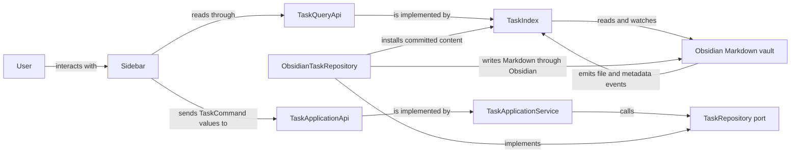

# Architecture

Abyss Tasks manages Markdown tasks through an Obsidian sidebar, with task lists, a calendar,
project views, and Analysis. Markdown is the durable record. The plugin builds read models over
the vault and writes user changes through application commands.

## System at a glance

Queries return detached, immutable snapshots. Commands validate current source, perform writes,
and return structured outcomes. Successful writes enter the read model before the command returns;
later vault and metadata events reconcile through the same parsing path as manual edits.

## Sources of truth

| Concern                                                 | Authoritative source                                         | Derived or temporary state            |
| ------------------------------------------------------- | ------------------------------------------------------------ | ------------------------------------- |
| Tasks, planning, comments, recurrence, and dependencies | Vault Markdown                                               | TaskIndex snapshots and projections   |
| Tracked time                                            | Markdown time entry lines                                    | TimeEntryIndex and totals             |
| Project membership and fields                           | Project Markdown and configured membership/field definitions | ProjectStore snapshots and statistics |
| Static preferences                                      | Plugin `data.json`                                           | Composed runtime CalendarSettings     |
| Saved list, section, and project views                  | Versioned plugin `state.json`                                | Composed runtime CalendarSettings     |
| Navigation, selection, search, drafts, and gestures     | AppState or the owning controller for the session            | Rendered DOM                          |

`TaskIndex` and `ProjectStore` are rebuildable. `AppState` coordinates the interface and does not
persist it. Saved preferences remain separate from transient interaction state. CalendarMode owns
its date and view type; StatisticsMode owns Analysis choices for its session.

## Dependency and write boundaries

[`src/main.ts`](src/main.ts) is the task-system composition root and Obsidian lifecycle entry point.
It loads settings, builds the status catalog and concrete task adapters, injects capabilities,
registers views and commands, and starts and stops plugin services. Consumers do not construct
alternate task repositories, indexes, or Search services.

| Boundary                                         | Responsibility and dependencies                                                                                                                                 |
| ------------------------------------------------ | --------------------------------------------------------------------------------------------------------------------------------------------------------------- |
| [Task public API](src/tasks/index.ts)            | Presentation's entry point for task queries, commands, capture, Search, Statistics sources, and task values                                                     |
| [Task domain](src/tasks/domain/)                 | Immutable values, identity, validation, status, recurrence, dates, and time; depends on itself, deterministic `rrule`, and shared tag syntax                    |
| [Task application](src/tasks/application/)       | Use cases and validation through domain contracts and application ports; no Obsidian or presentation imports                                                    |
| [Task infrastructure](src/tasks/infrastructure/) | Obsidian adapters, index, codec, source editing, and reference authority; depends inward, with explicit host, Markdown, scheduler, and search-engine boundaries |
| [Shared Markdown](src/markdown/)                 | Source syntax and display/search parsing; imports no task layer                                                                                                 |
| [Presentation](src/panels/)                      | Views and interactions over public capabilities; no task Markdown writer                                                                                        |

[`TaskApplicationApi`](src/tasks/application/TaskApplicationApi.ts) exposes commands and composed
query capabilities. [`TaskSearchApi`](src/tasks/application/TaskSearchApi.ts) separates shared
retrieval from canonical organization and exact hydration. Statistics has a separate retained-source
capability. Infrastructure never imports UI. [`src/parser/`](src/parser/) is a legacy presentation
adapter with a narrow codec-import exception; new task behavior belongs in `src/tasks/`.

Text writes have named owners: `ObsidianTaskRepository` for task transactions, `ProjectManager`
for project metadata, `NoteTemplateService` for note preparation, and `TagManager` for global tag
renames. Settings writes use composition-root ports. The exact file/owner/API authorizations and
the reasons for exceptions live in [`storageAuthority.ts`](test/architecture/storageAuthority.ts).
Passing data to a renderer or deriving a projection grants no write authority.

## Task source and command flow

### Identity and reconciliation

[`TaskIndex`](src/tasks/infrastructure/TaskIndex.ts) discovers tasks from Markdown through the
canonical [`TaskMarkdownCodec`](src/tasks/infrastructure/markdown/TaskMarkdownCodec.ts). Host
list-item metadata enriches discovery; omissions cannot remove authored tasks. Source exclusions
apply before public projections, while excluded content remains available for repository proof.
Host-cache frontmatter supplies presentation values, with authored frontmatter as fallback.

Initial discovery starts after layout readiness. Vault reads remain concurrent, while each
initialization attempt owns a cancellable queue for accepting their results. The queue yields
between atomic file installations after a short time or work budget, rechecks file ownership,
and drains before publishing readiness. Retired attempts cannot accept late reads or failures.
Repository commits and metadata observations retain synchronous acceptance. One large file can
still exceed the slice budget; this is cooperative scheduling on the host thread.

Edits preserve unrelated Markdown and identify the actual authored block or occurrence. Rendering,
matching text, file/line position, and link labels confer no write authority.
[`TaskRefAuthority`](src/tasks/infrastructure/TaskRefAuthority.ts) distinguishes occurrences and
records proven successors without adding identity metadata to notes. Each write requires a fresh,
unambiguous source match. Descendants retain their root and full ancestry.

The repository installs committed content before returning. A conflicting cache observation must
be confirmed by a fresh vault read before replacing it. Accepted reconciliation publishes a signal
even when tasks are unchanged or absent; `ProjectStore` waits for it before combining frontmatter
with task statistics. One failing subscriber cannot block other subscribers or that barrier.

### Commands and recovery

[`TaskApplicationService`](src/tasks/application/TaskApplicationService.ts) captures the clock and
behavior settings, validates commands, and delegates writes through ports. Conflict, invalid input,
missing or ambiguous targets, partial transfers, and I/O failures return structured outcomes.
The initiating presentation boundary reports them. A retry retains the operation's source proof
and policy; it cannot silently acquire a different target.

[`taskFileMutationQueue`](src/tasks/infrastructure/obsidian/taskFileMutationQueue.ts) orders
repository transactions, publication, and cleanup per App and path. Moves and archives prove the
destination before removing the source. Recovery compensates only exact content still owned by
the operation. Multi-note changes are not crash-atomic and can leave partial or unknown outcomes.
Archive batches retain a frozen destination and an outcome for content outside ordinary queries.

[`TaskHierarchyService`](src/tasks/application/TaskHierarchyService.ts) owns reparenting and
promotion. Same-note edits use one transaction; cross-note edits write the destination first.
Supported internal references are rebased; unprovable cross-note syntax is rejected. Inbound links
outside a moved subtree remain unchanged. Selection handoff follows the hierarchy outcome, not
line coincidence.

Explicit root deletion alone may remove an empty source note matching the current configured
`taskFilePath`, including valid historical date expansions. Other content, invalid frontmatter,
completion deletion, subtask deletion, and transfers have no such cleanup authority. Removal uses
Obsidian's deletion preference after fresh content and file-identity checks. The host has no
compare-and-trash API, so an external edit can still race removal. Cleanup failure reports a warning
on the successful task deletion; it does not retry or roll back that deletion. Undo cannot guarantee
recovery of a removed note.

### Capture and input

Capture owns a retained create session with destination, date, template, insertion policy, and
behavior settings. Planning and canonical previews do not write.
[`NoteTemplateService`](src/notes/NoteTemplateService.ts) prepares the destination at execution and
coordinates preparation of the same path. Uncertain preparation requires fresh proof before retry.
The application owns prefix, Inbox, and tag policy; presentation supplies typed input. Current source
exclusions still apply when a retained session writes.

Quick capture freezes its civil-time reference and smart-input preference on meaningful input.
The composition root injects offline English/Russian recognition and recurrence parsing through
`TaskInputServices`. Pure input models preserve raw text, manual choices, protected source ranges,
and occurrence-specific suppression. Canonical preview and submission share the same frozen policy;
recognition cannot consume protected Markdown or invent an authored title. Other capture surfaces
retain their existing capabilities. Recognition and draft state are transient.

A submitted request is frozen separately from newer input. Known unchanged failures permit explicit
retry; unknown outcomes require the user to inspect the destination before repeating. Blur never
retries a failed write. Shared capture interaction ownership settles nested drafts before submission
and retains the session across remounts. Kanban's optional initial status is validated during the
single creation transaction, without a second status write.

### Dependencies, recurrence, and time

Tasks-compatible `🆔` and `⛔` carriers are the dependency record. The index derives a graph from
persisted nodes and current status semantics, excluding recurrence forecasts.
[`TaskDependencyService`](src/tasks/application/TaskDependencyService.ts) revalidates exact targets,
graph constraints, and completion blockers at the write boundary. Linked-child creation writes the
child and edge together; mutation coordination is shared across service instances.

Nested time-entry lines are the sole tracked-time record. Invalid entries remain visible but do
not contribute totals. [`TimeTrackingService`](src/tasks/application/TimeTrackingService.ts) shares
dependency mutation coordination. Starting a timer closes other running entries before opening it.
Completion/cancellation closes affected subtree timers in a follow-up write using the captured
clock. A failed follow-up leaves the status committed and the entries visible for repair. Manual
status edits do not trigger writes. Recurring successors start without prior tracking entries.

Recurrence forecasts are bounded derived values with no direct write authority. Edits resolve the
persisted source through existing adapters. The domain owns recurrence parsing, canonical English
labels; invalid stored rules remain visible as authored. Timing normalization
applies to creation and explicit timing edits; reads and unrelated edits preserve legacy values.

## Search and read models

[`TaskSearchService`](src/tasks/infrastructure/search/TaskSearchService.ts) is one lazy, plugin-owned
service. Consumers own requests, cursors, and subscriptions; shared preparation and recovery survive
an individual caller's cancellation. Worker execution has an inline fallback and bounded recovery.
Unload disposes Search before TaskIndex. The inward
[`MiniSearchTaskEngine`](src/tasks/infrastructure/search/MiniSearchTaskEngine.ts) is the only
MiniSearch import boundary.

TaskIndex owns source generations, exact compact addresses, and a separate semantic revision for
status changes. Hydration returns detached roots/nodes in bounded batches and rejects stale
addresses. Search never uses write-reconciliation authority to revive a stale hit. Worker messages
contain search documents and compact results, not task references or source-bearing snapshots.

Root Search can match across descendants. Node search normally uses the node's title and tags;
Tasks Filter opts into subtree matching and then applies list membership and organization. Project
Filter and Global Search retain root populations. Nonempty Tasks Filter exposes outermost eligible
exact nodes, retaining nested matches as context rather than promoting ineligible ancestors.
[`searchMatchPolicy`](src/tasks/domain/searchMatchPolicy.ts) and
[`markdown/searchText`](src/markdown/searchText.ts) define matching and visible-text provenance.

Retrieval, complete logical organization, hydration, and DOM mounting have separate lifetimes.
[`TaskSearch`](src/panels/center/TaskSearch.ts) joins query publication, dependency readiness, and
current render receipts before reporting completion. Scrolling changes demanded mounts, not the
query. Source changes, new input, cancellation, and disposal retire obsolete work. Mounted rows and
service cursors are bounded, though a matching tree may contain many context nodes.

The mounted `SearchStatus` owns accessible state and failure notices. Inward reads never create
Notices. Diagnostics omit query text, task content, paths, and arbitrary exception causes. Hidden
preparation failures stay quiet until an active surface needs feedback.

## Presentation and interaction ownership

[`PanelView`](src/views/PanelView.ts) owns AppState, the shell, panels, shortcuts, and their lifetimes.
It injects capabilities; child views do not create independent task writers or shell subscriptions.

| Owner                                               | Responsibility                                                                             |
| --------------------------------------------------- | ------------------------------------------------------------------------------------------ |
| [CompactPaneAccess](src/views/CompactPaneAccess.ts) | Responsive pane access and local focus                                                     |
| [LeftPanel](src/panels/LeftPanel.ts)                | Navigation, counts, and tag/project creation routing                                       |
| [CenterPanel](src/panels/CenterPanel.ts)            | Modes, task contexts, queries, selection, hydration, capture, and shared card interactions |
| [RightPanel](src/panels/RightPanel.ts)              | Inspector commands, drafts, recovery, Undo, history, and result ordering                   |
| [TaskModal](src/ui/TaskModal.ts)                    | The same inspector with local AppState in a native Modal                                   |
| [CalendarSettingsTab](src/settings/SettingsTab.ts)  | Settings staging, persistence, retry, and semantic rebuild                                 |

Task surfaces reuse `TaskCommands`, `TaskMenus`, `CaptureSessions`, `ListViewControls`, and
[`TaskCardRenderer`](src/panels/center/TaskCardRenderer.ts). The shared
[`taskContextMenu`](src/ui/taskContextMenu.ts) receives exact nodes and surface-owned actions.
Descendant actions target that node; CenterPanel owns bulk routing. Inspector owners render and
invoke retained callbacks while RightPanel keeps submission and recovery authority.

RightPanel keeps submitted targets and values separate from newer live input. Continuation, focus,
and selection after a write require command-specific successor proof. Unproved drafts stay with
their original owner; guarded Undo/history cannot overwrite external edits. Later user navigation
and selection take precedence over delayed callbacks. Cancellation after submission does not cancel
the submitted write. Project navigation settles the active project editor before changing mode;
invalid drafts retain the current view.

[`TaskListStatusPublication`](src/panels/task-list/TaskListStatusPublication.ts) holds presentation
through a captured status/card press, menu, drag, and command, including an intervening inspector
save. Queries remain live. Advancing the actionable subject requires exact source continuity or a
proven command successor. This proof lasts only for that interaction; external replacement, semantic
change, navigation, cancellation, or owner loss revokes it.

[`RetainedTaskText`](src/ui/retainedTaskText.ts) and
[`renderTaskText`](src/ui/renderTaskText.ts) own field rendering through Obsidian MarkdownRenderer,
the source path, and finite Components. Receipts settle after current Markdown and link wiring are
ready. Replacement/disposal invalidates old callbacks. Editable links require whole-field alignment
and exact authored occurrence proof; highlighting and excerpts add no write authority. Shared
[WikiLinkSuggest](src/ui/WikiLinkSuggest.ts) owns completion UI only for its editor's lifetime;
existing capture and inspector commands still persist the draft.

Each surface uses its owning document/window and retires listeners, observers, timers, frames,
subscriptions, and Components on hide, disposal, or window migration as appropriate. Retained
controllers keep drafts while native resources remount. Interaction leases, Obsidian Scopes, and the
shared shortcut router respect editors, IME, and nested surfaces. Native Modal Back first dismisses
its newest nested surface; focus returns only to a connected opener still owned by the interaction.
Obsidian owns the mobile keyboard inset.

## Task collections and Calendar

[`taskNodeMembership`](src/task-lists/taskNodeMembership.ts) supplies shared membership. Lists and
tags can include roots and descendants by their own metadata; untagged Inbox admits roots only.
Project collections and Global Search retain roots. Temporal lists apply status and lifecycle dates;
Scheduled contributes independently of Start/Due. Sidebar counts deduplicate active physical nodes
independently of saved center filters.

[`taskOccupiedDates`](src/tasks/domain/taskOccupiedDates.ts) describes inclusive Start/Due ranges
or distinct authored points for calendar geometry. Occurrence completion capability is
separate from the physical node. Grouping may display that node more than once: logical keys identify
rows, while commands identify source nodes. Selection and keyboard ranges follow complete logical
order; counts and bulk writes deduplicate physical targets. Selection survives only exact identity
or proven source transitions. PanelView invalidates civil dates without writing Markdown.

[`TaskListSurface`](src/panels/task-list/TaskListSurface.ts) mounts bounded keyed rows over
[`RowViewport`](src/panels/virtualization/rowViewport.ts). DOM owns geometry, focus, and active
interaction pins; logical rows own order and selection. Current render receipts authorize geometry.
Source replacement, owner changes, and disposal revoke stale measurement and interaction authority.
Scroll anchors and exact reveals yield to newer user scrolling and focus.

Tasks List, Kanban, and Timeline share this surface and card renderer. Kanban owns status-column
geometry and per-column viewports; offscreen viewports release unpinned rows while retaining columns.
Column order comes from configured status order. Drops change the captured task or selected batch
through existing status commands. Task ranks and source-order writes are not introduced. A successful
single drop reveals its committed node after publication; bulk drops provide column feedback.

Timeline maps Start/Due to a range and Scheduled to a separate marker; malformed ranges retain their
authored values. Shared project axis, navigation, geometry, and pointer components drive the view.
The task adapter captures canonical references and submits one guarded date patch through
`TaskCommands`. Moving an open range preserves absent endpoints. CenterPanel retains queries,
selection, hydration, and receipts; layout scroll anchors remain session state. Timeline owners
retain the shared [`projectTimelineViewport`](src/projects/projectTimelineViewport.ts) geometry and
logical center through refresh, resize, and window migration. Their existing frame owners rebase
the bounded physical track, patch calendar layers, and compensate native horizontal scroll together;
scrolling does not rebuild task cards or project models. Axis slices retain overlapping date cells.
Explicit Timeline entry and the active scale button center Today; other scales preserve the fractional
center. Pending initial focus waits for usable geometry and yields to later reveals or user scrolling.

The project dashboard embeds this same task shell. ProjectsPanel owns project details, while
CenterPanel supplies the note-scoped task context. Preferences share `project:<path>` with Tasks'
project list; dashboard queries remain independent session state per path. Source-note metadata is
suppressed only when a task's source matches the current project. Leaving the dashboard releases
its task interactions, capture, search, and selection.

CalendarMode owns period, selected day, forecasts, and view lifetime. Its occurrence projection is
shared by full and constrained layouts. `CalendarCommands` maps gestures to public commands;
`CalendarEditQueue` orders pointer/keyboard writes and advances sources only through whole-tree
owned-change proof. Failed or unproved receipts invalidate dependent queued edits. Temporary
planning previews never grant replacement-source authority or change stored planning themselves.

Calendar publication holds retain the physical gesture target through native activation and
submitted preview settlement. Explicit cancellation and owner changes retire pending gestures.
Forecast edits resolve their persisted source without granting forecast status/drag identity.
Capture retains its frozen date and draft through publications and width/date changes, mounting
only when its destination context is visible.

## Projects

[`ProjectStore`](src/projects/ProjectStore.ts) evaluates configured membership from paths, tags, and
frontmatter, then combines reconciled tasks into statistics. Its cache is derived.
[`ProjectManager`](src/projects/ProjectManager.ts) owns creation and guarded metadata writes; task
moves use TaskApplicationApi.

[`projectFields`](src/projects/projectFields.ts) owns case-insensitive lookup, exact source binding,
and the shared catalog. Project status is a configured frontmatter property with literal definitions,
independent of tags. Curated types are fixed. Custom definitions and presets are static configuration,
independent of column visibility and native discovery. Native adapters suggest types/values without
changing Obsidian's registry. Ambiguous or unsupported bindings preserve data and make affected roles
read-only. Removing a definition does not delete note metadata; derived statistics remain read-only.

[`projectTableModel`](src/projects/projectTableModel.ts) supplies shared search, typed filtering,
sorting, grouping, and counts. Pure models receive explicit time and data. The retained
[`ProjectsTableView`](src/panels/projects/ProjectsTableView.ts) shares toolbar, field rendering,
editors, mutation queues, history, and clipboard logic across Table, Kanban, and Timeline. Surfaces
retain separate organization, selection, and viewport state. Logical cells drive keyboard movement,
selection and reveal across windowed DOM. Clipboard content conveys values, not write authority.

The overview orders actions; ProjectManager serializes metadata operations per App. Transactions
recheck field/type binding, source key, property presence, and expected value. Queued status writes
also retain the chosen definition's meaning. Batches return applied/failed receipts. Successful
receipts project immediately until verified source observations acknowledge or supersede them;
ordinary refresh cannot discard them. Rename, deletion, and membership loss retire affected paths.
[`ProjectEditHistory`](src/projects/projectEditHistory.ts) uses bounded session receipts for guarded
Undo/Redo while preserving external edits and bindings.

Project Kanban ranks are saved view state. Drops validate group meaning, write metadata, and change
rank only after success; filtering preserves hidden ranks. Timeline preview and persistence share
one endpoint plan and validate both endpoints together. Surfaces use bounded geometry and pin active
editors/gestures. Shared `TimelinePointerInteraction` owns native gesture lifetime;
`timelinePresentation` shares axis/scale-button rendering. Active and submitted pointer previews
retain calendar ranges and reproject into the current window on rebases, cancellation, or failed
writes. Row and dashboard boundary affordances use the exposed date viewport independently of the
larger physical buffer. Adapters retain their own source and write authority.

Dashboard properties reuse [`projectTableCells`](src/panels/projects/projectTableCells.ts), presets,
and `ProjectCellEditor`. `createFieldEditorSession` captures effective type and exact source state,
then submits through the overview's queue, history, and receipts. This also owns inline checkbox and
list changes. The dashboard owns finite Markdown, popover, and editor resources and retains active
anchors and focus on refresh. Its floating field editor belongs to the properties menu's focus
scope; value changes keep both surfaces open. Configured empty properties stay available for editing.

`ProjectDashboardTimeline` overlays Start/End handles on the shared sticky date axis and extends
their lines through the task date tracks. It adds no row or vertical space; the task viewport
measures the calendar axis as its inset. The axis height provides separate endpoint hit targets.
Its edits share overview endpoint guards, mutation ordering, receipt projection, and history through
ProjectManager. Project range changes never derive task dates or add task metadata.

Creation shares NoteTemplateService and retains the owned path/failed phase for recovery. Status
renames coordinate metadata and settings writes, compensating only owned values. Recovery across
notes and settings is best effort and not crash-atomic.

## Analysis and Statistics

[`TaskStatisticsSource`](src/tasks/application/TaskStatisticsSource.ts) is a separate retained read
capability. Its first subscriber activates
[`TaskStatisticsProjection`](src/tasks/infrastructure/TaskStatisticsProjection.ts); its last releases
extra evidence and pending work. Permitted archive evidence uses the canonical codec without entering
ordinary task, dependency, tracking, or reference-authority indexes. Tightened policy removes
forbidden cached evidence immediately.

Failures retain last-good permitted evidence and expose coverage issues. Ready means acquisition
settled, not complete coverage. Transfer publication holds prevent intermediate copies from appearing
as completed observations; partial transfers expose actual retained copies without content
deduplication. Statistics and ProjectStore settlement support coherent observations.

Pure [`src/statistics/`](src/statistics/) receives explicit time, calendar, projects, and scope.
Physical nodes preserve live/archive provenance, date issues, and their own tracking entries.
Open/aging/dependency populations use live records; historical metrics may include archives. Coverage
is independent of totals; chart caps do not remove underlying evidence.

[`StatisticsMode`](src/panels/statistics/StatisticsMode.ts) subscribes while visible and owns session
choices, preparation, diagnostics, and retry. Charts are staged before replacing last-good content.
[`TanStackStatisticsChart`](src/panels/statistics/TanStackStatisticsChart.ts) is the sole TanStack
Charts import boundary and cannot select/classify sources. Evidence mounts shared cards for exact
live nodes; archive rows can only open a verified retained source.

## Settings and compatibility

[`SettingsPersistenceCoordinator`](src/settings/persistence.ts) serializes `data.json` and adjacent
`state.json` through composition-root ports. One composed CalendarSettings object is the runtime
authority. Static and view-state saves remain separate. Status changes rebuild task catalog,
registry, and index semantics together. Navigation, search choices, drafts, gestures, history, and
Analysis state remain transient.

Saved views write schema 2 and read schema 1/legacy data. Migration retains a recovery snapshot,
writes and verifies the envelope, then cleans moved static keys. Recognized state wins over legacy
copies. Missing state after migration uses defaults without recapturing stale keys. Corrupt,
unreadable, or future-version state stays untouched: view writes suspend and temporary defaults are
used, while static saves preserve guarded legacy fields. Older schema-1 binaries suspend writes to
schema 2; re-upgrading restores those views.

Each saved `ListViewState` can choose a layout and independent Kanban/Timeline organization. Explicit
property filters are shared; effective layout settings preserve List preferences. Malformed layout
preferences recover independently. Ordinary saves preserve unknown static and nested view extensions.
Detached writes queue in order. Their latest staged envelope supplies extensions for subsequent
snapshots; completion cannot replace newer intent, and a rejected write does not block later operations.

Deleting a status definition removes its exact saved visibility, collapse, rank, and task-filter
references, while preserving unrelated state and authored note values. Static definitions are saved
before cleaned view state. Retryable failures retain the current draft and offer retry; these separate file
writes are not a transaction. Unknown raw project statuses remain independent values.

[`ViewStatePathOwner`](src/settings/ViewStatePathOwner.ts) forwards note rename/delete events to the
persistence coordinator, which rebases both runtime preferences and their retained raw extensions;
PanelNavigator owns session navigation. [`tagViewState`](src/settings/tagViewState.ts) preserves raw
view entries and unknown fields through tag rename and rejects conflicting destinations before vault
writes. [`TagManager`](src/tags/TagManager.ts) owns tag configuration and global rename. Discovered
groups remain derived until configured. Navigation archives change visibility without task writes.
Shared [`tagSyntax`](src/markdown/tagSyntax.ts) defines Unicode/nested-tag validity and case identity;
writes preserve authored spelling.

Archive-path/source-exclusion changes form one validated draft; only successful persistence changes
effective policy. Versioned custom-property definitions prevent rediscovery from undoing explicit
schema choices. Unsupported versions preserve data and disable schema edits. Persisted-contract
changes require migration, fallback, and rollback design. Presentation convenience alone cannot
justify new task metadata.

Shared Markdown and task-domain readers retain separate dependencies and agreement tests. Source
and shipped code avoid regex lookbehind for older iOS engines.
[`obsidianMoment.ts`](src/obsidianMoment.ts) is the host Moment import boundary; its callable-type
correction preserves Obsidian's runtime instance.

## Architecture checks

| Contract                                   | Enforcement                                                                                                                                     |
| ------------------------------------------ | ----------------------------------------------------------------------------------------------------------------------------------------------- |
| Import direction and public task consumers | [Dependency rules](dependency-cruiser.config.cjs), [architecture tests](test/architecture-boundaries.test.ts)                                   |
| Text-write acquisition                     | [Exact storage roster](test/architecture/storageAuthority.ts), [audit](test/storage-authority.test.ts)                                          |
| Settings ownership and migration           | [Key classification](test/architecture/settingsOwnership.ts), [coordinator tests](test/settings-persistence.test.ts)                            |
| Pure models and native lifetime            | [ESLint rosters](eslint.config.mts), [project policy](eslint-project-policy.mts), [lifecycle tests](test/project-owner-lifecycle.test.ts)       |
| Host compatibility                         | [Lint parity](test/obsidian-lint-parity.test.ts), [community review](test/store-review.test.ts), [artifact tests](test/build-artifacts.test.ts) |
| CSS scope, tokens, and runtime variables   | [CSS policy](tooling/css-policy.mjs), [finite contracts](tooling/css-contracts.mjs)                                                             |

New write acquisitions, settings keys, pure modules, and dynamic CSS contracts require exact roster
entries and tests. Fix violations at their source. Styles use plugin-owned scopes and semantic host
tokens. Static checks cannot establish every capability flow, native lifetime, layout, or contrast.

`pnpm verify` is the authoritative full gate; `verify:task` supports iteration. CI/pre-push use
[`verify-changes.mjs`](tooling/verify-changes.mjs); behavior, tooling, and uncertain history require
full verification, including authored and freshly built artifact CSS. See [AGENTS.md](AGENTS.md)
for workflow and native UI requirements, and [PERFORMANCE.md](PERFORMANCE.md) for performance work.
UI changes require dev-vault interaction, screenshots, DOM evidence, and runtime-error checks at
normal and constrained widths. Releases need an explicit request and the existing release workflow.

Update this document when ownership, public boundaries, dependency direction, critical data flow,
or persisted authority changes. Algorithms and local rendering details belong in source and tests;
proposed architecture belongs in ignored design specs.
